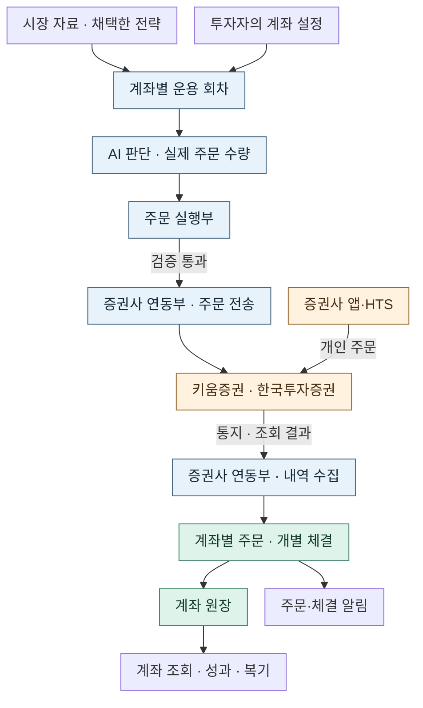
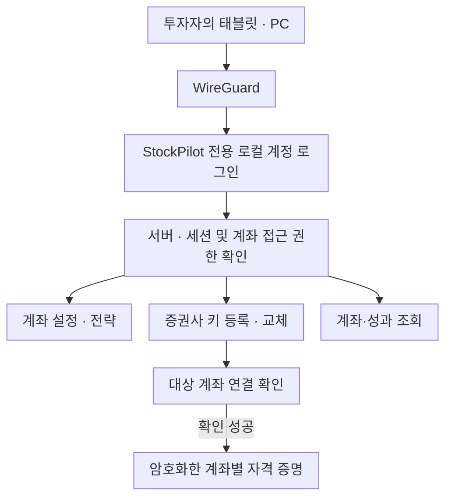
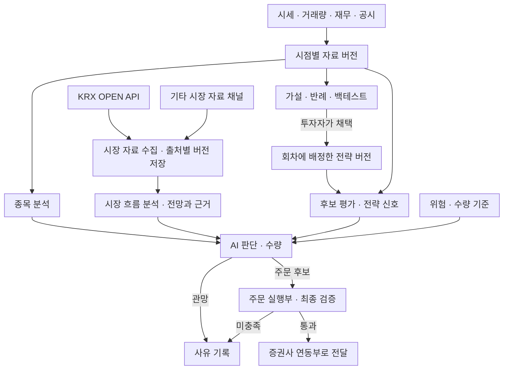
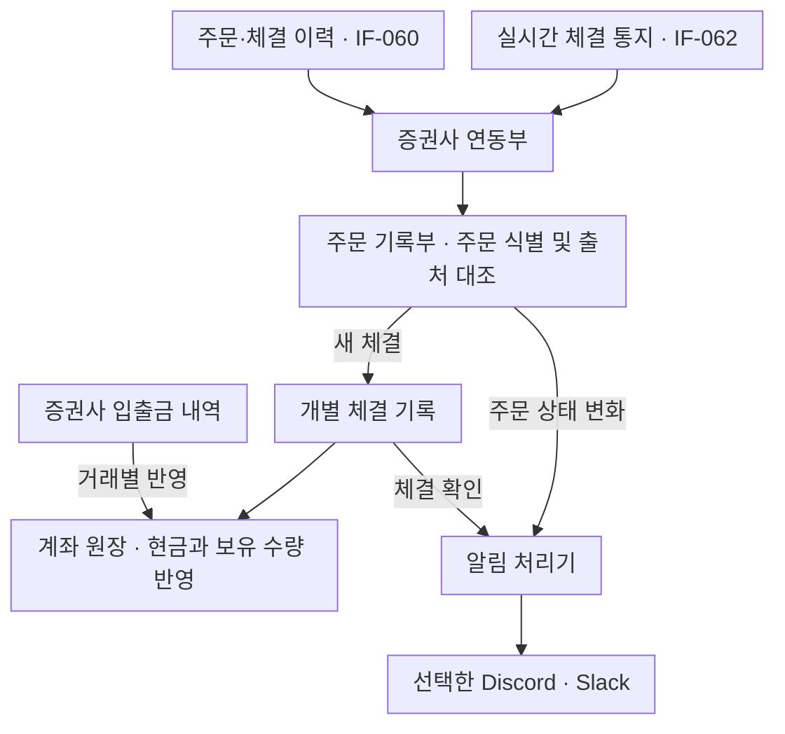

# StockPilot 전체 아키텍처

StockPilot은 거래일마다 오전·오후·장 마감 전 세 번, 계좌에 배정한 전략을 평가한다. 장중에 시작한 전략은 다음 회차가 열려도 해당 거래일 동안 계속 실행한다. AI가 사용자 기준 안에서 실제 주문 수량을 정하고 주문 실행부가 전송 직전 계좌 상태를 확인한다. 증권사에서 직접 낸 개인 주문과 이미 전송한 자동주문은 회차가 끝나거나 자동매매를 꺼도 계속 추적한다.

StockPilot은 설계 문서 서버와 별도의 RAM 16GB 리눅스 서버에서 운영한다. 리눅스 배포판과 버전은 추후 정한다. 각 구성요소의 구현 기술과 서버 프로세스 배치는 [기술 스택 권장안](<기술 스택.md>)에 정리했다.

## 1. 전체 구성

화살표는 입력이나 결과가 이동하는 방향이다. ‘계좌별 운용 회차’에서 자동매매를 따라가거나, ‘증권사 앱·HTS’에서 개인 주문을 따라가면 두 경로가 같은 계좌 기록으로 이어진다.

‘주문 전송’과 ‘내역 수집’은 같은 증권사 연동부의 두 역할이다. 계좌 원장의 현금·보유 수량과 주문 기록의 미체결 잔량은 다음 주문 검증에 다시 쓰인다. 그림의 상자는 업무 책임을 나타낸다. 프로세스 분리, 저장소 배치, 이벤트 전달 방식은 구현 단계에서 정한다.

## 2. 사용자 접속과 계좌 설정

| 투자자가 정하는 항목 | 적용하는 곳 |
| --- | --- |
| 증권사와 계좌 | 서버가 세션과 계좌 소속을 검사한다. 연동부는 해당 계좌를 조회해 키를 확인하고 사용한다. 화면에는 연결 상태와 마스킹한 식별 정보를 표시한다. |
| 계좌별 자동매매 켜기·끄기, 운용 정액(원) 또는 비율(%) | 회차 실행부가 운용 대상을 고르고, 주문 실행부는 전송 직전 주문 계좌의 잔여 한도만 적용한다. 각 계좌의 정액·비율 한도는 독립적이다. |
| AI 모델, 개인 위험 기준, 주문 수량 기준 | AI 판단부가 회차에 적용한 모델·기준·수량을 기록한다. 주문 실행부도 수량 기준을 확인한다. |
| 회차별 전략, 주간 목표 수익률 | 회차 실행부가 배정된 전략 버전을 읽는다. 성과 리포트가 해당 주의 목표와 실제 수익률을 비교한다. |

VPN은 집과 외부 모두에서 제품 화면·API에 접근하기 위한 조건이다. 접속한 투자자는 전용 아이디와 비밀번호로 로그인한다. 증권사 API 호출, 체결 통지 수신, Discord·Slack 전달은 서버 측 연동이다. 자격 증명의 원문은 연동부에서만 사용하며 화면 응답·AI 입력·로그에서 제외한다. [로그인과 세션](<인터페이스 정의서.md#if-001>) · [키 등록](<인터페이스 정의서.md#if-005>) · [운용 설정](<인터페이스 정의서.md#if-010>)

## 3. 전략 연구에서 실계좌 주문까지

1. **자료와 연구.** 수집부는 가격·거래량과 재무·공시의 원본·정정 버전을 보관한다. 종목 분석은 지표의 기준 시점을 남기고, 시장 분석은 전망 기간과 향후 평가일을 남긴다. 연구부는 투자자의 가설과 AI가 제시한 반례를 기록하고, 같은 기간·거래 비용을 적용해 기준 전략과 비교한다. 투자자가 채택한 버전을 회차에 배정한다. [자료 이력](<인터페이스 정의서.md#if-032>) · [백테스트](<인터페이스 정의서.md#if-034>) · [전략 채택](<인터페이스 정의서.md#if-055>)
2. **회차와 판단.** 계좌별 실행 이력에는 거래일·회차, 배정 전략, 후보 순위와 제외 사유가 남는다. AI는 전략 신호, 종목 분석, 시장 전망, 계좌 위험을 함께 읽는다. 매수·매도 의견에는 사용자 기준으로 결정한 실제 수량을 붙이고 관망에는 사유를 남긴다. 입력 버전, 설정, 사용 모델과 원래 응답을 판단에 연결한다. [후보 조회](<인터페이스 정의서.md#if-027>) · [AI 판단](<인터페이스 정의서.md#if-037>)
3. **전송 직전 검증.** 주문 실행부는 최신 계좌 ON/OFF와 자동 중지 상태, 사용자 수량 기준을 확인한다. 매수는 가용 현금과 기존 운용액·미체결 매수분을 고려한 잔여 한도, 매도는 매도 가능 수량을 확인한다. 기준을 벗어난 후보는 사유를 기록하고 전송을 보류한다. 같은 계좌·주문 의도는 한 건으로 식별한다. 손실 기준 도달이나 연속 주문 실패로 중지된 계좌에도 이 검증이 적용된다. [최종 검증](<인터페이스 정의서.md#if-038>) · [주문 전송](<인터페이스 정의서.md#if-040>) · [자동 중지](<인터페이스 정의서.md#if-057>)

**과거 회차 재생**은 저장된 회차를 읽는 별도 경로다. 당시 이용 가능했던 자료와 전략 버전, 원래 AI 응답, 실제 체결을 찾아 판단과 결과를 복기한다. 재생은 조회·비교에서 끝나므로 ‘주문 전송’이 호출되지 않는다. [회차 재생](<인터페이스 정의서.md#if-030>) · [AI 역할](<AI 스킬 목록.md>)

### 시장 분석용 데이터 수집

KRX OPEN API는 시장 자료를 수집하는 채널 중 하나다. 수집부는 거래일별 KOSPI·KOSDAQ 지수 시세와 시장별 일별매매정보를 저장한다. 시장 분석부는 이 자료에서 지수 등락률과 시장별 거래대금 변화를 계산하고, 다른 채널의 관측값과 함께 시장 흐름을 해석한다. 시장 전체의 거래대금을 집계할 때는 해당 시장의 수집 범위를 기록한다. [KRX 공식 서비스 목록](https://openapi.krx.co.kr/contents/OPP/INFO/service/OPPINFO004.cmd)

수집 주기는 자료 제공 주기를 따른다. 원본에 출처·기준 거래일·수신 시각·자료 버전을 남긴다. 각 매매 회차는 그 시각까지 확보한 시장 분석 결과를 읽고, AI는 해당 결과와 배정 전략의 신호, 개인 위험 기준을 함께 검토한다. [자료 수집](<인터페이스 정의서.md#if-032>) · [시장 분석 화면](<화면 정의서.md#ui-011>)

### 매수·매도 주문 전송 지연

세 회차는 AI가 판단하는 시점이다. 회차에서 매수 또는 매도 방향과 실제 수량이 준비되면 실행부는 바로 최종 검증을 시작한다. 자동매매 상태·계좌별 한도·매도 가능 수량·중복을 확인하고 주문 의도를 영속화한 뒤, 같은 실행 흐름에서 증권사 연동부를 호출한다. 매수와 매도 모두 다음 스케줄이나 공용 작업 큐의 순번을 기다리는 단계를 두지 않는다. 알림과 리포트는 기록된 사건을 별도로 처리한다. [최종 검증](<인터페이스 정의서.md#if-038>) · [주문 전송](<인터페이스 정의서.md#if-040>)

회차에서 정한 매수·매도 조건은 해당 거래일 동안 유지한다. 실시간 가격 조건은 증권사 WebSocket 시세로 감시하고, 장중 조건이 충족되면 처음 배정한 회차와 전략 버전에 연결해 최종 검증을 시작한다. 다음 회차의 시작만으로 진행 중인 전략을 교체하거나 같은 주문 조건을 중복 등록하지 않는다. [기술 스택](<기술 스택.md>) · [MyFin 코드 대조](<MyFin 기존 구현 지도.md>)

일반 전략은 Celery가 1분마다 확정 분봉으로 평가한다. 단타 전략만 시세 WebSocket을 구독한다. 계좌 주문·체결 통보는 양쪽에서 수신한다. 진행 중인 조건은 다음 회차에도 유지하고, 신규 후보는 증권사 등록 여유와 서버 메모리·처리 지연을 확인한 뒤 감시한다. 감시 중단·대기 사유는 홈과 전략·운용에서 확인한다. [실시간 감시 용량](<기술 스택.md>) · [배정 순서](<전략·운용 규칙서.md>)

## 4. 직접 주문과 자동주문이 같은 원장에 반영되는 과정

| 기록을 맡는 곳 | 식별 기준과 재처리 결과 |
| --- | --- |
| 주문 실행부·주문 기록부 | 자동주문은 계좌와 주문 의도 `(account_id, intent_id)`로 한 번 등록한다. 증권사 주문번호를 계좌·거래일·증권사와 함께 대조해 출처를 연결한다. 직접 낸 주문도 수집하며, 출처 확인에 필요한 근거가 부족하면 ‘미확인’으로 둔다. |
| 주문 기록부 | 주문 하나에 체결 여러 건을 연결한다. 실시간 통지와 뒤이은 조회에서 같은 `(order_id, broker_fill_key)`가 나오면 기존 `fill_id`를 사용한다. |
| 계좌 원장 | `fill_postings.fill_id`로 하나의 체결을 한 번 반영하고 현금과 보유 수량을 함께 갱신한다. 입출금은 별도의 현금 흐름으로 기록한다. 대조할 때는 같은 기준 시각의 증권사 잔고를 사용한다. |
| 알림 처리기 | 전송, 접수·거절, 부분·전량 체결, 취소 결과를 기록된 상태 변화에서 읽는다. 계좌 별칭·종목·방향·주문 식별자와 발생 시각을 표시하고, 체결에는 체결가·이번 수량·누적 수량·잔량을 붙인다. 실패한 이벤트의 해당 채널 전달만 재시도한다. |

**접수 응답이 끊긴 경우.** 주문 상태를 ‘접수 확인 중’으로 기록하고 증권사의 주문·체결 이력을 조회한다. 대조로 접수 여부를 확인하기 전에는 동일 의도를 다시 전송하지 않는다. 잔량 취소를 요청한 뒤에도 증권사가 취소를 확정할 때까지 추가 체결이 들어올 수 있다. [주문 대조](<인터페이스 정의서.md#if-042>) · [체결 원장 반영](<인터페이스 정의서.md#if-046>) · [복구 절차](<운영·장애 복구서.md>)

**수량으로 검산하는 예.** 보유 0주에서 10주를 주문해 4주가 체결되고 잔량 6주의 취소를 요청한다. 그 사이 1주가 더 체결되고 같은 1주 통지를 두 번 받아도 최종 결과는 주문 1건, 체결 2건, 보유 5주, 취소 5주, 잔량 0주다. 자동매매 OFF 상태에서 증권사 앱으로 2주를 직접 산 경우에도 개인 주문 1건과 실제 체결이 조회되고 보유 수량이 2주 증가한다. [개인 주문 수집](<인터페이스 정의서.md#if-050>) · [상태 전이](<업무 흐름·상태 전이서.md>) · [인수 기준](<테스트·인수 기준서.md>)

## 5. 투자자가 결과를 확인하는 곳

| 화면·기능 | 읽는 기록과 확인할 수 있는 내용 |
| --- | --- |
| 계좌·포트폴리오 | 계좌별 현금·보유·주문 가능 금액과 기준 시각을 확인한다. 잔고 차이가 있으면 재동기화를 요청하고 대조 결과를 조회한다. [계좌 상세](<인터페이스 정의서.md#if-004>) · [재동기화](<인터페이스 정의서.md#if-019>) · [포트폴리오](<인터페이스 정의서.md#if-052>) |
| 관심종목·회차 이력 | 투자자가 관리하는 관심종목, 특정 회차에서 실제 평가한 후보의 순위와 제외 이유, AI 판단 근거를 각각 조회한다. [관심종목](<인터페이스 정의서.md#if-023>) · [회차 이력](<인터페이스 정의서.md#if-026>) |
| 주문·손익 | 주문 이력에서는 주문 출처와 개별 체결을 확인한다. ‘매매 방식별 실현손익’에서는 ‘매매 방식’으로 직접 매매·자동매매·혼합·미확인을 조회한다. 직접 산 주식을 자동으로 팔면 매도 주문의 출처는 자동이고 해당 매매의 실현손익은 혼합에 한 번 집계된다. 종목별 평가손익 이력은 별도로 조회한다. [주문 상세](<인터페이스 정의서.md#if-018>) · [평가손익](<인터페이스 정의서.md#if-021>) · [실현손익](<인터페이스 정의서.md#if-022>) |
| 주간 성과·매매일지 | 매주 초 운용 자산에 대한 목표와 실제 성과를 비교하고 입출금은 투자 수익과 구분한다. 목표가 3%이고 첫 주 100만 원으로 실제 순수익 3만 원을 재투자했다면, 입출금이 없을 때 다음 주 기준은 103만 원, 목표 수익은 30,900원이다. 예상가와 실제 체결가 차이, 시장 전망의 사후 평가, AI 해설을 확인한다. 투자자는 회차와 연결해 당시 생각과 사후 복기를 직접 기록한다. [주간 성과](<인터페이스 정의서.md#if-014>) · [체결가 분석](<인터페이스 정의서.md#if-031>) · [일지](<인터페이스 정의서.md#if-015>) |

## 6. 남은 설계 결정

| 결정할 사항 | 영향을 받는 부분 |
| --- | --- |
| 여러 계좌의 위험과 주간 성과를 어느 범위까지 합산해 평가할지 | 포트폴리오 위험 평가와 성과 리포트의 집계 범위. |
| 운용 비율의 기준 자산·재계산 시점, 서로 다른 주문 의도가 동시에 들어올 때 가용 예산을 확보하는 시점 | 최종 검증에서 각 주문에 허용할 금액과 수량 |
| 반대 신호가 미체결 주문과 겹칠 때의 처리, AI가 위험을 근거로 전략 신호를 보류할 조건, 자동 중지 후 재개 권한 | AI 판단, 잔량 취소, 계좌 운용 재개 |
| 회차의 정확한 시각, 수량 기준 단위·한도, 손실·실패 임계값, 주간 수익률의 세부 산식 | 스케줄, 설정 입력, 위험 평가와 성과 검증. 세부 수치는 개발 단계에서 정한다. |

기능별 범위는 [기능 정의서](<기능 정의서.md>), 운용 조건은 [전략·운용 규칙서](<전략·운용 규칙서.md>), 데이터 키와 관계는 [테이블 정의서](<테이블 정의서.md>), 기존 제품에서 참고한 구현은 [MyFin 기존 구현 지도](<MyFin 기존 구현 지도.md>)에서 확인할 수 있다.
