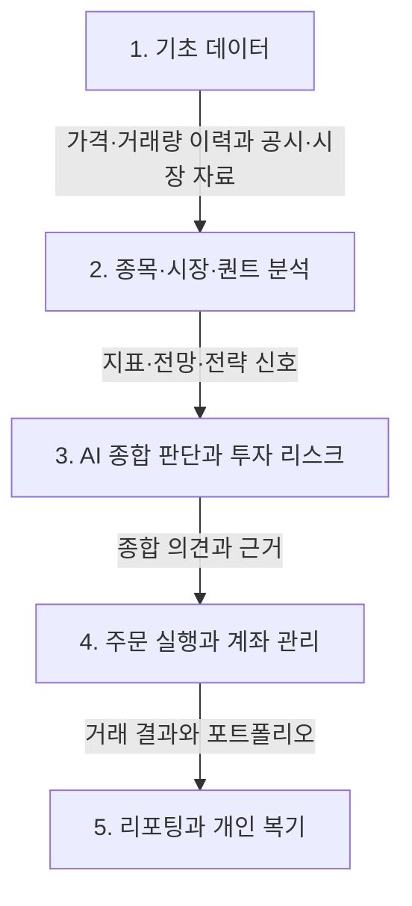
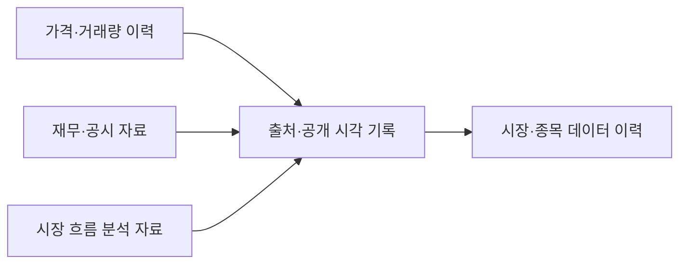
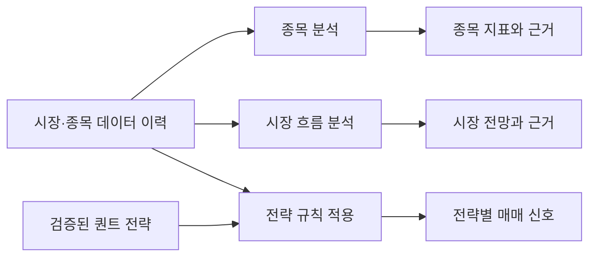
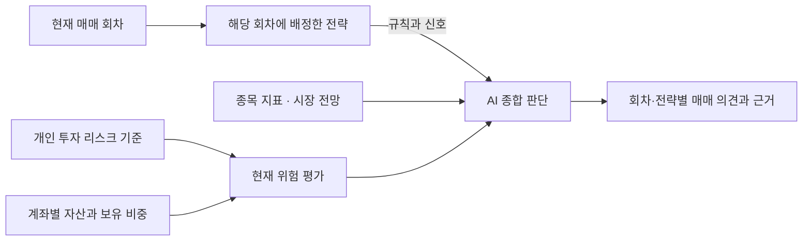
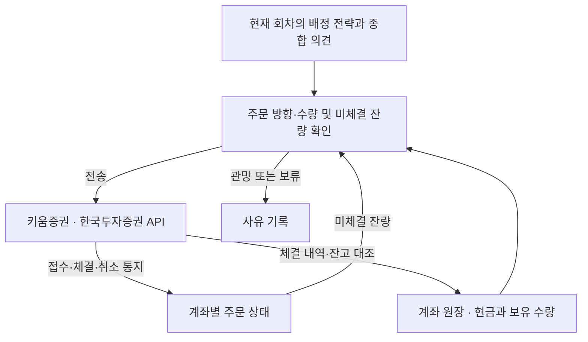
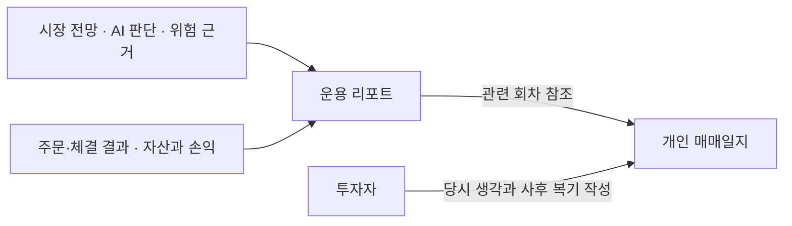

# StockPilot 전체 아키텍처 초안

**제품 목표**는 검증된 퀀트 전략, 기초 데이터에 근거한 종목 분석, 별도 프로세스가 산출한 시장 흐름을 AI가 종합하고 개인 투자 리스크 기준을 반영해 국내 주식을 자동매매하는 것이다. 키움증권·한국투자증권 실계좌에서 수익을 재투자해 장기적인 자산 성장을 추구한다. 매매 판단 회차는 거래일마다 오전·오후·장 마감 전 세 번이며, 정확한 시각은 추후 정한다.

## 계층 개요

기존 제품의 구조와 기능별 차용 후보는 [MyFin 기존 구현 지도](<MyFin 기존 구현 지도.md>)에서 확인한다.

화살표는 다음 계층에서 사용하는 결과를 뜻한다. 계좌 원장은 체결 때마다 갱신되며, 다음 매매 회차의 판단에도 쓰인다.

### 1. 기초 데이터

시세·거래량·공시는 자료별로 수집하고 이력을 쌓는다. 각 자료의 출처와 시스템에서 이용 가능해진 시각을 기록해, 과거 판단을 복기할 때 당시 알 수 있었던 자료를 찾는다. 수집 간격은 자료별 상세 설계에서 정한다.

### 2. 종목·시장·퀀트 분석

세 결과를 독립적으로 만든다. 시장 전망에는 평가할 기간과 근거를, 퀀트 신호에는 적용한 전략과 검증 기록을 연결한다.

전략 연구에서는 투자자가 학습한 아이디어를 가설로 등록하고, 한국 시장 자료로 기본 전략과 비교한다. 투자자가 타당성을 검토해 채택한 버전이 아래 ‘검증된 퀀트 전략’에 들어간다. 실험 과정과 반례는 [AI 스킬 목록의 개인 전략 연구 절차](<AI 스킬 목록.md>)를 따른다.

### 3. AI 종합 판단과 투자 리스크

투자자가 오전·오후·장 마감 전에 서로 다른 검증된 전략을 배정한다. 매매 시점이 되면 시스템이 해당 회차에 배정된 전략의 규칙과 신호를 불러온다. AI는 이 전략을 기준으로 종목 분석, 시장 흐름, 개인 투자 리스크를 종합한다. 데이터 수집과 분석 결과의 갱신 주기는 자료와 전략의 특성에 따라 정한다. AI의 수량 조정·관망 권한은 협의할 사항이다.

### 4. 주문 실행과 계좌 관리

신규 매매 판단은 세 회차에 이루어진다. 이미 전송한 주문의 접수·부분 체결·취소 결과는 회차 사이에도 추적한다. 주문 가능 수량을 확인할 때는 해당 계좌의 최신 상태를 사용한다.

#### 주문·체결 알림

매수·매도 모두 주문 상태가 바뀔 때마다 선택한 Discord 또는 Slack 채널로 알린다. 오전·오후·장 마감 전 회차 사이에 도착한 체결도 확인되는 즉시 전달한다.

| 알림 | 발생 기준 | 10주 매수 예시 |
| --- | --- | --- |
| 주문 전송 | StockPilot이 증권사에 주문 요청을 보냄 | 10주 매수 요청 전송 |
| 접수 확인 | 증권사가 주문 접수를 확인함 | 10주 매수 접수 확인 |
| 부분 체결 | 새 체결을 확인했고 잔량이 있음 | 이번 4주 체결 · 누적 4/10주 · 잔량 6주 |
| 전량 체결 | 새 체결로 주문 수량 전부가 체결됨 | 이번 6주 체결 · 누적 10/10주 · 잔량 0주 |

각 메시지에 발생 시각, 증권사·계좌 별칭, 종목, 매수·매도 방향, 주문 식별자를 표시하고 체결 메시지에는 이번 체결가를 덧붙인다. 접수 거절이나 취소 확인도 실제 결과에 맞는 상태로 알린다. 증권사 접수가 불확실하면 ‘접수 확인 중’으로 표시한다.

알림 처리기는 기록된 주문·체결 이벤트를 읽어 전달한다. 같은 체결 통지가 반복되면 체결 식별자로 중복을 판별하고, 메시지 전송 실패 시 해당 알림만 재시도한다.

### 5. 리포팅과 개인 복기

리포트는 시스템의 판단과 결과를 보여준다. 투자자는 관련 회차를 참조해 당시 생각을 직접 적고, 나중에 결과를 본 뒤 배운 점을 덧붙인다.

## 구성요소별 책임

| 영역 | 책임과 경계 |
| --- | --- |
| 시장 데이터 | 시세와 공시에 출처 및 당시 이용 가능했던 시각을 기록해 분석과 백테스트에 제공한다. |
| 종목 분석 | 분석 당시 이용 가능했던 과거·현재 데이터에서 종목 지표를 산출한다. 종합 판단에서 수치의 출처와 기준 시점을 확인할 수 있게 한다. |
| 시장 흐름 분석 | 별도 프로세스가 관측 자료로부터 시장 전망을 산출한다. 근거·기간·평가일을 함께 기록해 나중에 실제 결과와 비교한다. |
| 퀀트 전략 | 기존 전략의 규칙, 적용 조건, 검증 기간과 결과를 보관한다. 검증된 버전을 데이터에 적용해 전략이 정한 주기로 신호를 계산한다. AI는 이 규칙과 결과를 읽는다. |
| 개인 투자 리스크 평가 | 계좌의 현재 위험을 사용자 기준에 따라 평가한다. AI가 이 평가와 기준을 읽고 전략 신호에 따른 위험을 종합 결과에 반영한다. AI 판단이 실제 주문을 조정할 수 있는 범위는 협의한다. |
| AI 종합 판단 | 종목 분석, 퀀트 전략과 신호, 시장 흐름, 투자 리스크를 함께 읽는다. 신호가 일치하거나 충돌한 근거와 종합 결과를 기록한다. |
| 주문 실행 제어 | 계좌·종목별로 매수·매도 신호, 위험 점검 결과, 주문 가능 현금·수량, 기존 주문의 미체결 잔량을 함께 확인한다. 실제 주문의 방향·수량과 전송 또는 보류 사유를 기록하고 체결 상태를 추적한다. |
| 증권사 연동 | 실행부가 결정한 주문을 해당 계좌로 전달하고 접수·체결·잔고 정보를 가져온다. |
| 주문·체결 알림 | 주문 상태 변화를 Discord 또는 Slack으로 즉시 전달하고 주문별 이벤트와 채널별 전송 결과를 연결한다. |
| 포트폴리오 | 계좌별 현금과 보유 수량을 기록하고 증권사 잔고와 대조한다. 갱신된 가용 현금은 다음 매매 판단에 쓰인다. |
| 리포팅 | 자산 변화, 위험 판단, 시장 전망의 사후 평가를 원래 기록과 연결해 보여준다. |
| 개인 매매일지 | 투자자가 자신의 판단을 기록하고 결과를 돌아보며 투자 경험에서 배운다. 작성 예시로 당시 생각과 이유를 먼저 남기고, 나중에 같은 기록에 실제 결과와 다음에 확인할 점을 덧붙인다. 관련 회차의 AI 판단이나 체결 내역은 필요할 때 참조한다. |

## 먼저 정할 구조적 결정

시장 흐름과 개인 투자 리스크 평가가 퀀트 신호와 충돌하면 AI 종합 결과가 해당 회차의 주문 수량이나 실행 여부에 어느 정도 영향을 줄지 정한다.

매수 조건과 매도 조건이 겹치거나 기존 주문 처리 중 반대 신호가 들어올 때의 처리 원칙을 정한다. 예를 들어 10주 매수 중 4주 체결 시점에 매도 신호가 오면, 체결된 4주와 남은 매수 주문 6주를 구분해야 한다. 잔량 취소를 요청한 뒤에도 추가 체결될 수 있으므로 주문 가능 수량은 증권사의 최신 확인 결과를 기준으로 판단한다.

두 계좌를 하나의 포트폴리오로 운용할지, 계좌마다 독립적으로 운용할지 정한다. 이 결정에 따라 전략이 배분할 자금의 범위와 리스크 한도를 적용할 단위가 달라진다. 어느 방식이든 실제 주문과 체결은 해당 증권사 계좌에 귀속된다.
