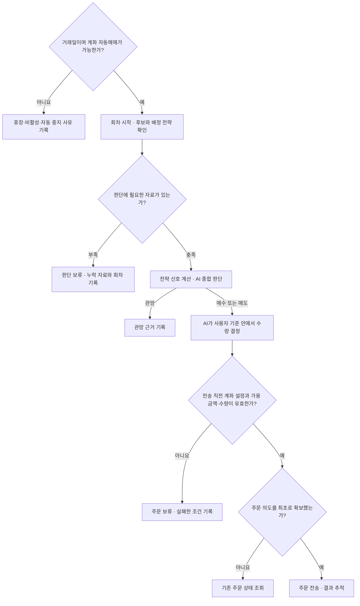

# StockPilot 업무 흐름·상태 전이서

회차 기록은 투자 판단이 어떻게 끝났는지를 보여주고, 주문 기록은 증권사에 보낸 요청이 어떻게 처리됐는지를 보여준다. 오전 회차가 끝난 뒤에도 오전 주문의 체결 결과는 해당 주문과 계좌 원장에 계속 반영한다. [기능 정의서](<기능 정의서.md>) · [전략·운용 규칙서](<전략·운용 규칙서.md>) · [용어 정의서](<용어 정의서.md>)

## 로그인부터 주간 복기까지

| 단계 | 시작하는 사람 또는 사건 | 다음 단계와 확인할 결과 |
|---|---|---|
| 조회 | 투자자가 WireGuard VPN에 연결한 뒤 전용 로컬 계정으로 로그인해 본인 증권 계좌를 선택한다. | 연결 상태, 현금, 보유 종목과 평가액을 확인한다. 조회만 한 경우 여기서 끝난다. |
| 계좌 준비 | 투자자가 설정에서 증권사 API 키를 등록하고 계좌 조회로 연결을 확인한다. | 계좌별 운용 한도(정액 또는 비율)와 AI 주문 수량 기준을 입력하고 자동매매를 켠다. 연결 확인에 실패하면 해당 계좌의 설정 화면에서 사유를 확인한다. |
| 전략 준비 | 투자자가 전략의 검증 결과를 확인하고 채택한 버전을 오전·오후·장 마감 전 회차에 배정한다. | 회차가 시작되면 실제 실행 버전과 판단 기준 시각을 기록한다. |
| 회차 판단 | 전략 엔진이 당시 이용 가능한 자료로 신호를 계산하고, AI가 종목·시장·계좌 위험과 함께 해석한다. | 관망이면 근거를 남긴다. 매매로 이어지면 AI가 사용자 기준 안에서 해당 계좌의 실제 주문 수량을 결정한다. |
| 주문과 체결 | 주문 실행부가 전송 직전에 계좌 활성 상태, 사용자 기준, 가용 금액·수량과 미체결 잔량을 확인한다. | 통과한 주문을 전송해 원래 회차와 연결한다. 증권사에서 확인한 개별 체결마다 현금과 보유 수량을 갱신하고 알린다. |
| 성과와 복기 | 투자자가 주간 리포트에서 회차를 선택한다. | 당시 AI 결정 수량, 실제 체결량, 원장 손익을 대조하고 매매일지에 복기를 남긴다. 해당 주의 실제 수익률을 주초 운용 자산 기준 목표(초기 약 3%)와 비교한다. 재투자한 실제 수익은 다음 주 시작 자산에 포함한다. |

## 진행 중인 전략의 장중 흐름

회차에서 조건 등록 → 당일 시세 감시 → 조건 충족 → 최신 계좌 상태로 최종 검증 → 전송 또는 보류 순으로 진행한다. 감시 중에 오후·장 마감 전 회차가 시작돼도 원래 전략 버전과 판단을 유지한다. 이미 전송한 주문은 증권사에서 최종 상태를 확인할 때까지 추적한다.

## 회차 판단의 분기

‘판단 보류’는 필요한 자료가 없어 판단을 마치지 못한 경우다. ‘관망’은 회차의 판단 결과이고, ‘주문 보류’는 주문 후보가 전송 조건을 충족하지 못한 경우다. 세 경로 모두 해당 사유를 회차에서 조회할 수 있다. 필수 자료의 범위와 신호 충돌 시 AI의 관망 의견으로 주문을 보류할 수 있는 조건은 개발 단계에서 정한다.

## 주문 한 건의 상태 전이

| 현재 상태 | 확인한 사건 | 다음 상태와 처리 |
|---|---|---|
| 전송 전 | 최종 검증 통과 후 매수·매도 요청 전송 | **전송됨**. 내부 주문을 계좌와 회차에 연결한다. |
| 전송됨 | 증권사 접수 확인 또는 거절 | **접수됨**이면 증권사 주문번호를 연결한다. **거절됨**이면 거절 사유를 남기고 종료한다. |
| 전송됨 | 접수 응답 유실 | **접수 확인 중**. 같은 주문을 재전송하지 않고 증권사 주문 내역과 대조한다. 확인되면 실제 접수·거절·체결 상태를 반영한다. |
| 접수됨 또는 부분 체결 | 새로운 체결 확인 | **부분 체결** 또는 **전량 체결**. 개별·누적 체결 수량과 잔량을 갱신한다. 일부 체결이 반복되면 상태명은 같아도 수량은 달라진다. |
| 접수됨 또는 부분 체결 | 미체결 잔량의 취소 요청 전송 | **취소 확인 중**. 취소 요청 시점의 실제 누적 체결량과 미체결 잔량을 유지한다. |
| 취소 확인 중 | 추가 체결 확인 | 새 체결을 원장에 반영한다. 잔량이 남으면 취소 결과를 기다리고, 주문량 전부가 체결됐으면 **전량 체결**로 표시한다. |
| 취소 확인 중 | 증권사가 취소 수량 확정 | 확정 수량만 잔량에서 뺀다. 잔량이 0이면 **취소 완료**로 표시하고 그전에 체결된 수량은 보존한다. |
| 취소 확인 중 | 증권사가 취소 거절 | 거절 사유와 원주문의 최신 상태를 조회한다. 여전히 미체결인 수량은 계속 추적한다. |

계좌의 자동매매를 끄면 신규 자동주문을 중지한다. 기존 주문의 상태는 증권사의 접수·체결·취소 결과에 따라 바뀐다. 알림 전달 결과도 주문과 별도로 기록한다. 같은 체결 통지가 반복되면 원장에 한 번만 반영하고, 알림 전달 실패 시 해당 메시지만 재시도한다.

## 개인 주문 수신과 접수 불명 복구

| 시점 | 확인할 기록 | 처리와 완료 기준 |
|---|---|---|
| 외부 주문 발견 | 연결 계좌의 증권사 주문번호, 거래일, 채널, 기존 전송 기록 | 일치하는 내부 주문에 연결한다. 증권사 앱·HTS 개인 주문은 회차 없이 저장한다. 근거가 부족하면 출처 미확인으로 둔다. |
| 재시작 또는 접수 응답 유실 | 전송 의도, 증권사 주문·체결 내역, 마지막 동기화 시각 | 같은 의도의 신규 전송을 보류한다. 계좌의 주문과 상세 체결을 다시 읽고 기존 주문에 연결한다. 조회 실패 시 ‘접수 확인 중’과 마지막 확인 시각을 유지한다. |
| 중복 체결 수신 | 같은 계좌·주문에서 이미 반영한 개별 체결 식별자 | 실시간 통지와 재동기화에 동일 체결이 있어도 원장의 현금·보유량 및 알림 이벤트는 한 번만 생성된다. |
| 복구 확인 | 원주문 체결 합계·취소 확정량·잔량과 증권사 내역, 원장 보유량 | 미확인 주문과 불일치 금액을 표시한다. 해당 주문의 대조 완료와 계좌의 자동매매 재개를 별도로 기록한다. 재개 조건·권한은 개발 단계에서 정한다. |

## 검토 사례 · 오전 매수 도중 오후 매도 신호가 온 경우

해당 종목의 시작 보유량은 0주다. 오전에 10주 매수 주문을 보냈고, 오후 회차에서 반대 신호를 검토한 뒤 오전 주문의 잔량 취소를 요청했다고 가정한다. 표의 수량은 전이를 확인하기 위한 예시다.

| 사건 | 오전 매수 주문 상태 | 누적 체결 | 취소 확정 | 미체결 잔량 | 계좌 보유 |
|---|---|---:|---:|---:|---:|
| 오전 주문 접수 | 접수됨 | 0주 | 0주 | 10주 | 0주 |
| 4주 체결 | 부분 체결 | 4주 | 0주 | 6주 | 4주 |
| 오후 매도 신호 기록 | 부분 체결 | 4주 | 0주 | 6주 | 4주 |
| 남은 6주 취소 요청 | 취소 확인 중 | 4주 | 0주 | 6주 | 4주 |
| 취소 확인 전 1주 추가 체결 | 취소 확인 중 | 5주 | 0주 | 5주 | 5주 |
| 같은 1주 체결 통지 재수신 | 취소 확인 중 | 5주 | 0주 | 5주 | 5주 |
| 증권사가 남은 5주 취소 확정 | 취소 완료 | 5주 | 5주 | 0주 | 5주 |

이 시점까지 실제 거래는 오전 주문에서 체결된 5주 매수다. 오후 매도 신호는 오후 회차에 남는다. 후속 매도 주문을 보낼 때는 최신 보유량, 증권사 매도 가능 수량과 사용자 기준으로 다시 검증한다. 반대 신호나 계좌 비활성화 시 잔량을 자동 취소할지, 회차 시각과 수량 산식을 어떻게 정할지는 개발 단계에 남긴다.
