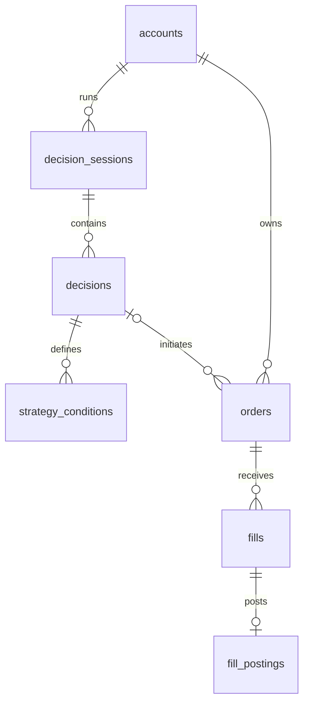

# StockPilot 테이블 정의서

**버전 v0.2 · 초안.** 첫 버전의 권장 DB인 PostgreSQL을 기준으로 작성했다. 계좌별 주문에는 원래 판단과 거래일을 연결하고, 한 주문의 개별 체결과 원장 반영을 각각 추적한다. 테이블명은 물리 이름 제안이며 API에서는 내부 숫자 ID를 문자열로 표현할 수 있다. [인터페이스 정의서](<인터페이스 정의서.md>) · [기술 스택](<기술 스택.md>)

## 테이블 목록

| 영역 | 테이블 | 한 행의 의미 |
| --- | --- | --- |
| 접속과 계좌 설정 | `audit_events` | 사용자 또는 시스템의 작업 결과 한 건 |
| 접속과 계좌 설정 | `users` | 로컬 사용자 |
| 접속과 계좌 설정 | `login_sessions` | 로그인 세션 |
| 접속과 계좌 설정 | `accounts` | 증권 계좌 |
| 접속과 계좌 설정 | `account_credentials` | 계좌 자격 증명 |
| 접속과 계좌 설정 | `account_settings` | 계좌 운용 설정 한 버전 |
| 접속과 계좌 설정 | `account_stops` | 자동 중지와 해제 이력 |
| 자료·전략·회차 | `market_data_versions` | 당시 이용 가능한 자료 한 버전 |
| 자료·전략·회차 | `market_outlooks` | 기간별 시장 전망과 사후 평가 |
| 자료·전략·회차 | `strategy_versions` | 투자자가 연구한 전략 한 버전 |
| 자료·전략·회차 | `backtest_runs` | 전략과 기준 전략의 비교 한 번 |
| 자료·전략·회차 | `strategy_assignments` | 사용자·거래일·회차의 전략 배정 |
| 자료·전략·회차 | `model_settings` | 사용자 AI 설정 한 버전 |
| 자료·전략·회차 | `decision_sessions` | 계좌별 회차 실행 결과 |
| 자료·전략·회차 | `candidates` | 회차에서 평가한 종목 |
| 자료·전략·회차 | `decisions` | 회차의 종목별 AI 판단 |
| 자료·전략·회차 | `decision_inputs` | 판단에 사용한 자료 버전 |
| 자료·전략·회차 | `replay_runs` | 원래 회차와 재생 결과의 비교 |
| 자료·전략·회차 | `strategy_conditions` | 당일 감시하는 매수·매도 조건 |
| 주문·체결·원장 | `orders` | 개인 또는 자동 주문 한 건 |
| 주문·체결·원장 | `cancel_requests` | 미체결 잔량 취소 요청 |
| 주문·체결·원장 | `order_events` | 주문 상태·취소·확인 사건 이력 |
| 주문·체결·원장 | `order_timings` | 자동주문 후보의 처리 시간과 검증 결과 |
| 주문·체결·원장 | `fills` | 주문의 개별 체결 |
| 주문·체결·원장 | `fill_postings` | 체결 하나의 현금·수량 반영 |
| 주문·체결·원장 | `fill_events` | 개별 체결과 주문 상태 사건 연결 |
| 주문·체결·원장 | `cash_movements` | 계좌 외부 입출금 한 건 |
| 주문·체결·원장 | `account_snapshots` | 계좌 현금·평가액 기준점 |
| 주문·체결·원장 | `position_snapshots` | 기준 시점의 종목 잔고 |
| 주문·체결·원장 | `sync_runs` | 주문·잔고 대조 한 번 |
| 성과·알림·개인 기록 | `realized_matches` | 한 매수 체결과 한 매도 체결 사이의 청산분 |
| 성과·알림·개인 기록 | `weekly_targets` | 투자자가 정한 주간 목표 |
| 성과·알림·개인 기록 | `weekly_results` | 계좌별 주간 성과 산출 근거 |
| 성과·알림·개인 기록 | `notification_channels` | 계좌별 알림 목적지 |
| 성과·알림·개인 기록 | `notification_deliveries` | 주문 사건의 채널별 전달 |
| 성과·알림·개인 기록 | `watchlist` | 사용자의 관심종목 한 건 |
| 성과·알림·개인 기록 | `journal_entries` | 개인 매매일지 |

## 핵심 관계



개인 주문은 증권사 내역에서 시작하고 판단 참조를 비워 둔다. 자동주문은 원래 판단과 계좌를 함께 확인한다. 실시간으로 들어온 체결은 이력 조회로 같은 체결을 발견해도 한 번만 원장에 반영한다.

## 컬럼 표기

`PK`는 기본 키, `FK`는 참조 대상이다. 복합 키는 각 테이블 아래에 적었다. 필수 컬럼에는 `NOT NULL`을 적용한다. 내부 자동 번호는 `bigint GENERATED ALWAYS AS IDENTITY`다. 원화 금액·단가·비율은 `numeric`, 주식 수량은 정수, 사건 시각은 `timestamptz`, 거래일은 한국 거래소 기준 `date`로 저장한다. 실거래·판단 기록은 참조가 남아 있는 동안 삭제를 제한한다. 표에 별도로 적지 않은 컬럼은 저장할 때 값을 제공한다.

## 접속과 계좌 설정

### users

로컬 사용자. [IF-001](<인터페이스 정의서.md#if-001>)

| 컬럼 | PostgreSQL 타입 | 필수 | 키 | 설명 |
| --- | --- | --- | --- | --- |
| `user_id` | `bigint` | 필수 | PK | 사용자 식별자 |
| `login_name` | `text` | 필수 | UNIQUE | 전용 로그인 아이디 |
| `password_hash` | `text` | 필수 | — | 비밀번호 검증용 해시 |

### audit_events

[감사 로그 조회](<인터페이스 정의서.md#if-063>) · [감사 사건 기록](<인터페이스 정의서.md#if-064>)

| 컬럼 | PostgreSQL 타입 | 필수 | 키 | 설명 |
| --- | --- | --- | --- | --- |
| `audit_id` | bigint | 필수 | PK | 감사 사건 번호 |
| `event_key` | text | 필수 | UNIQUE | 동일 사건 재처리 키 |
| `request_id` | text | 필수 | — | 관련 요청·작업 묶음 |
| `occurred_at` | timestamptz | 필수 | — | 사건 발생 시각 |
| `owner_user_id` | bigint | 선택 | FK → users | 이 사건을 조회할 수 있는 사용자. 소유자 미확인 시 NULL |
| `actor_type`, `actor_id` | text | 필수, 선택 | — | 행위자 유형과 확인한 사용자 또는 서비스 ID |
| `account_id` | bigint | 선택 | FK → accounts | 작업 대상 계좌 |
| `action`, `target_type`, `target_id` | text | 필수, 필수, 선택 | — | 작업 코드, 대상 종류, 대상 ID |
| `outcome`, `reason_code` | text | 필수, 선택 | — | 작업 결과와 실패·거절 사유 |
| `changes` | jsonb | 선택 | — | 기록 허용 목록에 있는 설정의 전후 값 |

응용 프로그램에는 추가·허가된 조회 권한만 부여한다. 설정 변경 성공은 변경 행과 감사 행을 같은 트랜잭션에서 확정한다. 실패·거절은 원작업 롤백 뒤에도 기록한다. 주문 관련 감사 사건은 기존 주문 의도·상태 사건과 함께 영속화하거나 그 기록에서 비동기로 생성한다. 비동기 처리는 재시작 후 누락분을 다시 읽으며 감사 기록을 위해 주문을 재전송하지 않는다. 사용자별 시간순 목록 인덱스는 `(owner_user_id, occurred_at DESC, audit_id DESC)`다. 보존 기간은 운영 정책에서 정한다.

### login_sessions

로그인 세션. [IF-001·002](<인터페이스 정의서.md#if-001>)

| 컬럼 | PostgreSQL 타입 | 필수 | 키 | 설명 |
| --- | --- | --- | --- | --- |
| `session_key_hash` | `bytea` | 필수 | PK | 브라우저 세션 토큰 해시 |
| `user_id` | `bigint` | 필수 | FK → `users` | 로그인 사용자 |
| `expires_at` | `timestamptz` | 필수 | — | 만료 시각 |
| `revoked_at` | `timestamptz` | 선택 | — | 로그아웃 시각 |

### accounts

증권 계좌. [IF-003·004](<인터페이스 정의서.md#if-003>)

| 컬럼 | PostgreSQL 타입 | 필수 | 키 | 설명 |
| --- | --- | --- | --- | --- |
| `account_id` | `bigint` | 필수 | PK | 계좌 식별자 |
| `user_id` | `bigint` | 필수 | FK → `users` | 계좌 소유자 |
| `broker` | `text` | 필수 | — | 증권사 코드 |
| `broker_account_key` | `text` | 필수 | — | 계좌번호의 보호된 대조 키 |
| `account_alias` | `text` | 필수 | — | 화면에 표시할 이름 |
| `connection_status` | `text` | 필수 | — | 연결 확인 결과 |

- `UNIQUE (user_id, broker, broker_account_key)`

### account_credentials

계좌 자격 증명. [IF-005~008](<인터페이스 정의서.md#if-005>)

| 컬럼 | PostgreSQL 타입 | 필수 | 키 | 설명 |
| --- | --- | --- | --- | --- |
| `account_id` | `bigint` | 필수 | FK → `accounts`, PK | 대상 계좌 |
| `secret_ciphertext` | `bytea` | 필수 | — | 검증한 증권사 키의 암호문 |
| `key_ref` | `text` | 필수 | — | 서버 측 암호화 키 참조 |
| `verified_at` | `timestamptz` | 필수 | — | 대상 계좌 조회 성공 시각 |

### account_settings

계좌 운용 설정 한 버전. [IF-009·010](<인터페이스 정의서.md#if-009>)

| 컬럼 | PostgreSQL 타입 | 필수 | 키 | 설명 |
| --- | --- | --- | --- | --- |
| `account_id` | `bigint` | 필수 | FK → `accounts` | 설정 대상 계좌 |
| `version` | `bigint` | 필수 | — | 계좌별 설정 버전 |
| `effective_at` | `timestamptz` | 필수 | — | 적용 시각 |
| `auto_enabled` | `boolean` | 필수 | — | 투자자가 지정한 자동매매 활성 상태 |
| `limit_mode` | `text` | 필수 | — | amount 정액 또는 percent 비율 |
| `limit_value` | `numeric` | 필수 | — | 계좌별 한도 값(원 또는 %) |
| `qty_unit` | `text` | 필수 | — | 주문별 수량 기준 단위 |
| `qty_value` | `numeric` | 필수 | — | 해당 단위의 사용자 설정값 |
| `risk_policy` | `jsonb` | 필수 | — | 이 버전에 적용한 위험 기준 |

- `PRIMARY KEY (account_id, version)`
- `CHECK (limit_mode IN ('amount','percent') AND limit_value >= 0 AND (limit_mode <> 'percent' OR limit_value <= 100))`

### account_stops

자동 중지와 해제 이력. [IF-057](<인터페이스 정의서.md#if-057>)

| 컬럼 | PostgreSQL 타입 | 필수 | 키 | 설명 |
| --- | --- | --- | --- | --- |
| `event_id` | `text` | 필수 | PK | 중복 중지 통지를 식별하는 키 |
| `account_id` | `bigint` | 필수 | FK → `accounts` | 대상 계좌 |
| `stop_type` | `text` | 필수 | — | 손실 기준 도달 또는 연속 주문 실패 |
| `risk_version` | `text` | 필수 | — | 평가 기준 버전 |
| `reason` | `text` | 필수 | — | 중지 사유 |
| `occurred_at` | `timestamptz` | 필수 | — | 중지 시작 |
| `resolved_at` | `timestamptz` | 선택 | — | 해제 확인 시각 |

## 자료·전략·회차

### market_data_versions

당시 이용 가능한 자료 한 버전. [IF-032·033·056](<인터페이스 정의서.md#if-032>)

| 컬럼 | PostgreSQL 타입 | 필수 | 키 | 설명 |
| --- | --- | --- | --- | --- |
| `data_id` | `bigint` | 필수 | PK | 자료 버전 식별자 |
| `source` | `text` | 필수 | — | 공급원 |
| `source_key` | `text` | 필수 | — | 공급원 안의 관측값·공시 식별자 |
| `version` | `text` | 필수 | — | 원본 또는 정정 버전 |
| `observed_at` | `timestamptz` | 필수 | — | 관측 또는 공시 기준 시각 |
| `available_at` | `timestamptz` | 필수 | — | 시스템이 이용할 수 있게 된 시각 |
| `payload` | `jsonb` | 필수 | — | 가격·거래량·재무·공시 원자료 |

- `UNIQUE (source, source_key, version)`

### market_outlooks

기간별 시장 전망과 사후 평가. [IF-036·056](<인터페이스 정의서.md#if-036>)

| 컬럼 | PostgreSQL 타입 | 필수 | 키 | 설명 |
| --- | --- | --- | --- | --- |
| `outlook_id` | `bigint` | 필수 | PK | 전망 식별자 |
| `as_of` | `timestamptz` | 필수 | — | 전망 기준 시각 |
| `horizon_end` | `date` | 필수 | — | 전망 평가일 |
| `evidence` | `jsonb` | 필수 | — | 입력 자료 버전과 전망 근거 |
| `forecast` | `text` | 필수 | — | 당시 전망 |
| `evaluation` | `jsonb` | 선택 | — | 평가 시각과 실제 결과 |

### strategy_versions

투자자가 연구한 전략 한 버전. [IF-034·053~055](<인터페이스 정의서.md#if-034>)

| 컬럼 | PostgreSQL 타입 | 필수 | 키 | 설명 |
| --- | --- | --- | --- | --- |
| `strategy_version` | `text` | 필수 | PK | 재사용하지 않는 전략 버전 키 |
| `strategy_id` | `text` | 필수 | 인덱스 | 같은 전략의 버전을 묶는 고정 키. 이름 변경 후에도 카드와 이력을 연결 |
| `user_id` | `bigint` | 필수 | FK → `users` | 연구한 사용자 |
| `hypothesis` | `text` | 필수 | — | 검증할 매매 가설 |
| `rules` | `jsonb` | 필수 | — | 전략 규칙·파라미터 |
| `research_notes` | `jsonb` | 필수 | — | 공개 소스의 저장소·커밋·경로, 학습 자료, 원본 대비 변경점과 반례 |
| `selection` | `text` | 필수 | — | 채택·보류·기각 또는 검토 중 |
| `selection_reason` | `text` | 선택 | — | 채택 여부 판단 근거 |

### backtest_runs

전략과 기준 전략의 비교 한 번. [IF-034](<인터페이스 정의서.md#if-034>)

| 컬럼 | PostgreSQL 타입 | 필수 | 키 | 설명 |
| --- | --- | --- | --- | --- |
| `backtest_id` | `bigint` | 필수 | PK | 실험 실행 키 |
| `strategy_version` | `text` | 필수 | FK → `strategy_versions` | 검증한 버전 |
| `input_manifest` | `jsonb` | 필수 | — | 평가 기간·자료 버전·비교 전략·비용 조건 |
| `result` | `jsonb` | 필수 | — | 성과·낙폭·표본 및 실패 사례 |
| `completed_at` | `timestamptz` | 선택 | — | 실행 종료 시각. 대기·실행 중에는 비움 |
| `run_kind` · `cycle_week` | `text` · `date` | 필수 | 인덱스 | 최초·주간·수동 재검증 유형과 대상 주차 |
| `criteria_version` · `checks` | `text` · `jsonb` | 기준 버전 필수 | — | 실행에 고정한 판정 기준과 항목별 목표·측정값·결과. 측정 전에는 값이 비어 있을 수 있다. |
| `run_status` · `verdict` | `text` · `text` | 상태 필수 | — | 대기·실행·완료·오류와 통과·미달·자료 부족을 구분 |
| `valid_until` | `timestamptz` | 선택 | — | 통과 판정의 유효 기한. 오류나 재시도로 연장하지 않는다. |

재검증은 새 실행 행을 추가한다. 같은 주차의 작업 재전달은 동일한 실행 키를 사용하고, 의도적인 재실행은 새 키를 발급한다. 이전 주차의 지연 응답이 현재 판정을 되돌리지 않도록 대상 주차와 시도 순서를 기준으로 적용한다. 보관·재개는 투자자 결정 이력에 실행 ID·시각·사유를 연결한다.

### strategy_assignments

사용자·거래일·회차의 전략 배정. [IF-012](<인터페이스 정의서.md#if-012>)

| 컬럼 | PostgreSQL 타입 | 필수 | 키 | 설명 |
| --- | --- | --- | --- | --- |
| `user_id` | `bigint` | 필수 | FK → `users` | 배정한 투자자 |
| `trade_date` | `date` | 필수 | — | 거래일 |
| `slot` | `text` | 필수 | — | 오전·오후·장 마감 전 |
| `strategy_version` | `text` | 필수 | FK → `strategy_versions` | 배정한 버전 |

- `PRIMARY KEY (user_id, trade_date, slot)`

### model_settings

사용자 AI 설정 한 버전. [IF-028·029](<인터페이스 정의서.md#if-028>)

| 컬럼 | PostgreSQL 타입 | 필수 | 키 | 설명 |
| --- | --- | --- | --- | --- |
| `model_settings_id` | `bigint` | 필수 | PK | 설정 버전 키 |
| `user_id` | `bigint` | 필수 | FK → `users` | 설정 소유자 |
| `provider` | `text` | 필수 | — | AI 공급자 |
| `model` | `text` | 필수 | — | 요청 모델명 |
| `effective_at` | `timestamptz` | 필수 | — | 적용 시각 |

### decision_sessions

계좌별 회차 실행 결과. [IF-013·026](<인터페이스 정의서.md#if-013>)

| 컬럼 | PostgreSQL 타입 | 필수 | 키 | 설명 |
| --- | --- | --- | --- | --- |
| `session_id` | `bigint` | 필수 | PK | 매매 회차 식별자 |
| `account_id` | `bigint` | 필수 | FK → `accounts` | 운용 계좌 |
| `trade_date` | `date` | 필수 | — | 회차의 거래일 |
| `slot` | `text` | 필수 | — | 매매 회차 구분 |
| `strategy_version` | `text` | 선택 | FK → `strategy_versions` | 실제 배정 버전. 미배정이면 비움 |
| `as_of` | `timestamptz` | 필수 | — | 데이터 조회 기준 |
| `result` | `text` | 필수 | — | 실행·건너뜀·실패 등 회차 결과 |
| `reason` | `text` | 선택 | — | 휴장·미배정·중지·실패 등의 사유 |

- `UNIQUE (account_id, trade_date, slot)`
- `UNIQUE (account_id, session_id)`

### candidates

회차에서 평가한 종목. [IF-027·035](<인터페이스 정의서.md#if-027>)

| 컬럼 | PostgreSQL 타입 | 필수 | 키 | 설명 |
| --- | --- | --- | --- | --- |
| `session_id` | `bigint` | 필수 | FK → `decision_sessions` | 평가한 회차 |
| `symbol` | `text` | 필수 | — | 종목 코드 |
| `rank_no` | `bigint` | 선택 | — | 순위가 부여된 경우의 순번 |
| `signal` | `jsonb` | 선택 | — | 전략 신호와 계산 근거 |
| `exclusion_reason` | `text` | 선택 | — | 제외한 이유 |

- `PRIMARY KEY (session_id, symbol)`

### decisions

회차의 종목별 AI 판단. [IF-013·037·038](<인터페이스 정의서.md#if-013>)

| 컬럼 | PostgreSQL 타입 | 필수 | 키 | 설명 |
| --- | --- | --- | --- | --- |
| `decision_id` | `bigint` | 필수 | PK | 판단 식별자 |
| `account_id` | `bigint` | 필수 | FK → `accounts` | 판단 계좌 |
| `session_id` | `bigint` | 필수 | — | 원래 실행 회차 |
| `symbol` | `text` | 필수 | — | 종목 코드 |
| `settings_version` | `bigint` | 필수 | — | 판단에 사용한 계좌 설정 버전 |
| `model_settings_id` | `bigint` | 필수 | FK → `model_settings` | 당시 공급자·모델 설정 |
| `opinion` | `text` | 필수 | — | 매수·매도·관망 등 판단 |
| `decided_qty` | `bigint` | 선택 | — | AI가 정한 주문 수량(주) |
| `reason` | `text` | 필수 | — | 판단 근거 또는 실패 사유 |
| `evidence` | `jsonb` | 필수 | — | 당시 계좌 위험·종목 분석·전략 신호·설정 입력 |
| `outlook_id` | `bigint` | 선택 | FK → `market_outlooks` | 판단에 참조한 전망 |
| `raw_response` | `jsonb` | 선택 | — | 비밀 정보 제거 후 보관한 원래 AI 응답과 실제 모델명 |
| `reference_price` | `numeric` | 선택 | — | 예상가와 체결가 비교에 쓸 당시 가격 |
| `decided_at` | `timestamptz` | 필수 | — | 판단 시각 |

- `FOREIGN KEY (account_id, session_id) REFERENCES decision_sessions(account_id, session_id)`
- `FOREIGN KEY (account_id, settings_version) REFERENCES account_settings(account_id, version)`
- `UNIQUE (account_id, decision_id)`
- `CHECK (decided_qty IS NULL OR decided_qty > 0)`

### decision_inputs

판단에 사용한 자료 버전. [IF-030·033·037](<인터페이스 정의서.md#if-030>)

| 컬럼 | PostgreSQL 타입 | 필수 | 키 | 설명 |
| --- | --- | --- | --- | --- |
| `decision_id` | `bigint` | 필수 | FK → `decisions` | 판단 |
| `data_id` | `bigint` | 필수 | FK → `market_data_versions` | 당시 읽은 자료 버전 |

- `PRIMARY KEY (decision_id, data_id)`

### replay_runs

원래 회차와 재생 결과의 비교. [IF-030](<인터페이스 정의서.md#if-030>)

| 컬럼 | PostgreSQL 타입 | 필수 | 키 | 설명 |
| --- | --- | --- | --- | --- |
| `replay_id` | `bigint` | 필수 | PK | 재생 실행 ID |
| `session_id` | `bigint` | 필수 | FK → `decision_sessions` | 재생 대상 회차 |
| `input_manifest` | `jsonb` | 필수 | — | 원래 자료·전략 버전과 판단 참조 |
| `comparison` | `jsonb` | 필수 | — | 재계산 신호·원래 판단·체결 비교 |
| `created_at` | `timestamptz` | 필수 | — | 재생 시각 |

### strategy_conditions

당일 감시하는 매수·매도 조건. [IF-035·038](<인터페이스 정의서.md#if-035>)

| 컬럼 | PostgreSQL 타입 | 필수 | 키 | 설명 |
| --- | --- | --- | --- | --- |
| `condition_id` | `bigint` | 필수 | PK | 감시 조건 키 |
| `decision_id` | `bigint` | 필수 | FK → `decisions` | 조건을 만든 최초 판단 |
| `condition_key` | `text` | 필수 | — | 판단 안의 조건 식별값 |
| `rule` | `jsonb` | 필수 | — | 조건식·방향·수량 기준 |
| `condition_state` | `text` | 필수 | — | 감시 중·충족·종료 |
| `valid_until` | `timestamptz` | 필수 | — | 해당 거래일 운용 종료 시각 |

- `UNIQUE (decision_id, condition_key)`

## 주문·체결·원장

### orders

개인 또는 자동 주문 한 건. [IF-017·018·040~045·050](<인터페이스 정의서.md#if-017>)

| 컬럼 | PostgreSQL 타입 | 필수 | 키 | 설명 |
| --- | --- | --- | --- | --- |
| `order_id` | `bigint` | 필수 | PK | 내부 주문 ID |
| `account_id` | `bigint` | 필수 | FK → `accounts` | 주문 계좌 |
| `decision_id` | `bigint` | 선택 | — | 자동주문의 원판단 |
| `intent_id` | `text` | 선택 | — | 자동주문 중복 전송 방지 키 |
| `condition_id` | `bigint` | 선택 | FK → `strategy_conditions` | 당일 조건 충족으로 생긴 주문의 원래 조건 |
| `order_source` | `text` | 필수 | — | automatic 자동·personal 개인·unknown 미확인 |
| `broker_order_id` | `text` | 선택 | — | 증권사에서 확인한 주문번호 |
| `trade_date` | `date` | 필수 | — | 증권사 거래일 |
| `ordered_at` | `timestamptz` | 필수 | — | 전송 의도 등록 또는 개인 주문의 원주문 시각 |
| `symbol` | `text` | 필수 | — | 종목 코드 |
| `side` | `text` | 필수 | — | buy 또는 sell |
| `order_qty` | `bigint` | 필수 | — | 주문 수량(주) |
| `limit_price_krw` | `numeric` | 선택 | — | 지정가(원/주) |
| `status` | `text` | 필수 | — | 내부 전송 준비 또는 인터페이스 주문 상태 |
| `cancelled_qty` | `bigint` | 선택 | — | 증권사가 확인한 누적 취소량(주) |

- `FOREIGN KEY (account_id, decision_id) REFERENCES decisions(account_id, decision_id)`
- `UNIQUE (account_id, order_id)`
- `CHECK (order_source IN ('automatic','personal','unknown') AND (order_source <> 'automatic' OR (decision_id IS NOT NULL AND intent_id IS NOT NULL)))`
- `CHECK (side IN ('buy','sell') AND order_qty > 0 AND (cancelled_qty IS NULL OR cancelled_qty BETWEEN 0 AND order_qty))`

### cancel_requests

미체결 잔량 취소 요청. [IF-043·044·061](<인터페이스 정의서.md#if-043>)

| 컬럼 | PostgreSQL 타입 | 필수 | 키 | 설명 |
| --- | --- | --- | --- | --- |
| `cancel_id` | `text` | 필수 | PK | 취소 재시도에도 유지하는 식별자 |
| `order_id` | `bigint` | 필수 | FK → `orders` | 원주문 |
| `cancel_qty` | `bigint` | 필수 | — | 요청 수량(주) |
| `confirmed_qty` | `bigint` | 선택 | — | 확인된 취소 수량(주) |
| `requested_at` | `timestamptz` | 필수 | — | 취소 요청 시각 |
| `status` | `text` | 필수 | — | 확인 중·확정·거절 |

- `CHECK (cancel_qty > 0 AND (confirmed_qty IS NULL OR confirmed_qty BETWEEN 0 AND cancel_qty))`

### order_events

주문 상태·취소·확인 사건 이력. [IF-041~045·048](<인터페이스 정의서.md#if-041>)

| 컬럼 | PostgreSQL 타입 | 필수 | 키 | 설명 |
| --- | --- | --- | --- | --- |
| `event_id` | `bigint` | 필수 | PK | 내부 상태 변경 사건 |
| `order_id` | `bigint` | 필수 | FK → `orders` | 대상 주문 |
| `event_key` | `text` | 필수 | — | 주문 내 동일 상태 사건의 재수신 대조 키 |
| `status` | `text` | 필수 | — | 변경 직후 주문 상태 |
| `occurred_at` | `timestamptz` | 필수 | — | 사건 시각 |
| `recorded_at` | `timestamptz` | 필수 | — | 내부 저장 시각 |
| `details` | `jsonb` | 필수 | — | 증권사 사유·당시 출처·누적 수량·취소량·확인 근거 |

- `UNIQUE (order_id, event_key)`
- `UNIQUE (order_id, event_id)`

### order_timings

자동주문 후보의 처리 시간과 검증 결과. [IF-038·040·041·059](<인터페이스 정의서.md#if-038>)

| 컬럼 | PostgreSQL 타입 | 필수 | 키 | 설명 |
| --- | --- | --- | --- | --- |
| `account_id` | `bigint` | 필수 | FK → `accounts` | 검증 대상 계좌 |
| `intent_id` | `text` | 필수 | — | 계좌 내 주문 의도 ID |
| `decision_id` | `bigint` | 필수 | — | AI 판단 |
| `order_id` | `bigint` | 선택 | — | 실제 주문을 등록한 경우 |
| `side` | `text` | 필수 | — | 매수·매도 집계 기준 |
| `candidate_at` | `timestamptz` | 필수 | — | 방향·수량이 갖춰진 시각 |
| `send_started_at` | `timestamptz` | 선택 | — | 실제 요청 송신 시작 시각 |
| `response_at` | `timestamptz` | 선택 | — | 첫 응답을 받은 시각 |
| `accepted_at` | `timestamptz` | 선택 | — | 접수 사실 확인 시각 |
| `result` | `text` | 필수 | — | 대기·전송·보류·거절·접수 확인 중 등 |
| `reason` | `text` | 선택 | — | 검증 실패·응답 유실 등 사유 |

- `FOREIGN KEY (account_id, order_id) REFERENCES orders(account_id, order_id)`
- `PRIMARY KEY (account_id, intent_id)`
- `FOREIGN KEY (account_id, decision_id) REFERENCES decisions(account_id, decision_id)`

### fills

주문의 개별 체결. [IF-045·046·062](<인터페이스 정의서.md#if-045>)

| 컬럼 | PostgreSQL 타입 | 필수 | 키 | 설명 |
| --- | --- | --- | --- | --- |
| `fill_id` | `bigint` | 필수 | PK | 확정한 개별 체결 ID |
| `order_id` | `bigint` | 필수 | FK → `orders` | 원주문 |
| `broker_fill_key` | `text` | 필수 | — | 같은 주문 안에서 체결을 식별하는 증권사 키 |
| `occurred_at` | `timestamptz` | 필수 | — | 증권사 체결 시각 |
| `fill_qty` | `bigint` | 필수 | — | 이번 체결 수량(주) |
| `fill_price_krw` | `numeric` | 필수 | — | 체결 단가(원/주) |

- `UNIQUE (order_id, broker_fill_key)`
- `CHECK (fill_qty > 0 AND fill_price_krw > 0)`

### fill_postings

체결 하나의 현금·수량 반영. [IF-046](<인터페이스 정의서.md#if-046>)

| 컬럼 | PostgreSQL 타입 | 필수 | 키 | 설명 |
| --- | --- | --- | --- | --- |
| `fill_id` | `bigint` | 필수 | FK → `fills`, PK | 원장에 반영한 체결 |
| `cash_delta_krw` | `numeric` | 필수 | — | 비용 포함 현금 증감(원) |
| `qty_delta` | `bigint` | 필수 | — | 매수는 양수·매도는 음수(주) |
| `posted_at` | `timestamptz` | 필수 | — | 원장 반영 시각 |

- `CHECK (qty_delta <> 0)`

### fill_events

개별 체결과 주문 상태 사건 연결. [IF-045·048](<인터페이스 정의서.md#if-045>)

| 컬럼 | PostgreSQL 타입 | 필수 | 키 | 설명 |
| --- | --- | --- | --- | --- |
| `fill_id` | `bigint` | 필수 | FK → `fills`, PK | 알림을 생성한 체결 |
| `event_id` | `bigint` | 필수 | FK → `order_events`, UNIQUE | 주문 기록부에 남긴 해당 체결 사건 |

### cash_movements

계좌 외부 입출금 한 건. [IF-051](<인터페이스 정의서.md#if-051>)

| 컬럼 | PostgreSQL 타입 | 필수 | 키 | 설명 |
| --- | --- | --- | --- | --- |
| `movement_id` | `bigint` | 필수 | PK | 내부 입출금 식별자 |
| `account_id` | `bigint` | 필수 | FK → `accounts` | 대상 계좌 |
| `source_key` | `text` | 필수 | — | 같은 증권사 자금 이동의 안정적인 키 |
| `amount_krw` | `numeric` | 필수 | — | 입금은 양수·출금은 음수(원) |
| `occurred_at` | `timestamptz` | 필수 | — | 이동 시각 |

- `UNIQUE (account_id, source_key)`
- `CHECK (amount_krw <> 0)`

### account_snapshots

계좌 현금·평가액 기준점. [IF-004·047·058](<인터페이스 정의서.md#if-004>)

| 컬럼 | PostgreSQL 타입 | 필수 | 키 | 설명 |
| --- | --- | --- | --- | --- |
| `snapshot_id` | `bigint` | 필수 | PK | 스냅샷 ID |
| `account_id` | `bigint` | 필수 | FK → `accounts` | 대상 계좌 |
| `as_of` | `timestamptz` | 필수 | — | 증권사 기준 시각 |
| `cash_krw` | `numeric` | 필수 | — | 계좌 현금 |
| `buying_power_krw` | `numeric` | 필수 | — | 증권사 매수 가능 금액 |
| `equity_krw` | `numeric` | 필수 | — | 해당 계좌 총평가액 |

- `UNIQUE (account_id, as_of)`

### position_snapshots

기준 시점의 종목 잔고. [IF-004·021·047](<인터페이스 정의서.md#if-004>)

| 컬럼 | PostgreSQL 타입 | 필수 | 키 | 설명 |
| --- | --- | --- | --- | --- |
| `snapshot_id` | `bigint` | 필수 | FK → `account_snapshots` | 계좌·시각 기준점 |
| `symbol` | `text` | 필수 | — | 보유 종목 |
| `position_qty` | `bigint` | 필수 | — | 보유 수량(주) |
| `sellable_qty` | `bigint` | 필수 | — | 매도 가능 수량(주) |
| `valuation_pnl_krw` | `numeric` | 필수 | — | 해당 시점 평가손익(원) |

- `PRIMARY KEY (snapshot_id, symbol)`

### sync_runs

주문·잔고 대조 한 번. [IF-019·020·042·047](<인터페이스 정의서.md#if-019>)

| 컬럼 | PostgreSQL 타입 | 필수 | 키 | 설명 |
| --- | --- | --- | --- | --- |
| `sync_run_id` | `bigint` | 필수 | PK | 대조 실행 ID |
| `account_id` | `bigint` | 필수 | FK → `accounts` | 대상 계좌 |
| `request_id` | `text` | 필수 | — | 중복 요청 식별자 |
| `started_at` | `timestamptz` | 필수 | — | 시작 시각 |
| `ended_at` | `timestamptz` | 선택 | — | 종료 시각 |
| `status` | `text` | 필수 | — | 진행·완료·실패 등 |
| `differences` | `jsonb` | 필수 | — | 기준 시각·대조 차이·미확인 내역 |

- `UNIQUE (account_id, request_id)`

## 성과·알림·개인 기록

### realized_matches

한 매수 체결과 한 매도 체결 사이의 청산분. [IF-022](<인터페이스 정의서.md#if-022>)

| 컬럼 | PostgreSQL 타입 | 필수 | 키 | 설명 |
| --- | --- | --- | --- | --- |
| `buy_fill_id` | `bigint` | 필수 | FK → `fills` | 취득 체결 |
| `sell_fill_id` | `bigint` | 필수 | FK → `fills` | 매도 체결 |
| `matched_qty` | `bigint` | 필수 | — | 두 체결 사이의 원가 대응 수량 |
| `net_pnl_krw` | `numeric` | 필수 | — | 해당 수량의 비용 반영 실현손익 |

- `PRIMARY KEY (sell_fill_id, buy_fill_id)`
- `CHECK (matched_qty > 0)`

### weekly_targets

투자자가 정한 주간 목표. [IF-011·014](<인터페이스 정의서.md#if-011>)

| 컬럼 | PostgreSQL 타입 | 필수 | 키 | 설명 |
| --- | --- | --- | --- | --- |
| `user_id` | `bigint` | 필수 | FK → `users` | 목표를 설정한 사용자 |
| `week_start` | `date` | 필수 | — | 적용 주 시작일 |
| `target_pct` | `numeric` | 필수 | — | 목표 수익률(%) |

- `PRIMARY KEY (user_id, week_start)`

### weekly_results

계좌별 주간 성과 산출 근거. [IF-014](<인터페이스 정의서.md#if-014>)

| 컬럼 | PostgreSQL 타입 | 필수 | 키 | 설명 |
| --- | --- | --- | --- | --- |
| `account_id` | `bigint` | 필수 | FK → `accounts` | 계좌별 집계 기준 |
| `week_start` | `date` | 필수 | — | 해당 주 시작일 |
| `opening_equity_krw` | `numeric` | 필수 | — | 주초 운용 자산 |
| `closing_equity_krw` | `numeric` | 필수 | — | 평가 기준일 운용 자산 |
| `net_flow_krw` | `numeric` | 필수 | — | 주중 순입출금 |
| `net_pnl_krw` | `numeric` | 필수 | — | 운용 손익 |
| `return_pct` | `numeric` | 선택 | — | 산출 가능한 경우 수익률 |
| `as_of` | `timestamptz` | 필수 | — | 집계 기준 시각 |

- `PRIMARY KEY (account_id, week_start)`

### notification_channels

계좌별 알림 목적지. [IF-048·049](<인터페이스 정의서.md#if-048>)

| 컬럼 | PostgreSQL 타입 | 필수 | 키 | 설명 |
| --- | --- | --- | --- | --- |
| `channel_id` | `bigint` | 필수 | PK | 채널 ID |
| `account_id` | `bigint` | 필수 | FK → `accounts` | 채널 적용 계좌 |
| `provider` | `text` | 필수 | — | Discord 또는 Slack |
| `webhook_ciphertext` | `bytea` | 필수 | — | 웹훅 주소 암호문 |
| `enabled` | `boolean` | 필수 | — | 전달 활성 상태 |

### notification_deliveries

주문 사건의 채널별 전달. [IF-048·049](<인터페이스 정의서.md#if-048>)

| 컬럼 | PostgreSQL 타입 | 필수 | 키 | 설명 |
| --- | --- | --- | --- | --- |
| `event_id` | `bigint` | 필수 | FK → `order_events` | 전달할 사건 |
| `channel_id` | `bigint` | 필수 | FK → `notification_channels` | 목적지 |
| `delivery_status` | `text` | 필수 | — | 대기·성공·실패 |
| `attempt_count` | `integer` | 필수 | — | 시도 횟수 |
| `last_result` | `text` | 선택 | — | 마지막 전달 결과 |

- `PRIMARY KEY (event_id, channel_id)`
- `CHECK (attempt_count >= 0)`

### watchlist

사용자의 관심종목 한 건. [IF-023~025](<인터페이스 정의서.md#if-023>)

| 컬럼 | PostgreSQL 타입 | 필수 | 키 | 설명 |
| --- | --- | --- | --- | --- |
| `user_id` | `bigint` | 필수 | FK → `users` | 목록 소유자 |
| `symbol` | `text` | 필수 | — | 관심종목 코드 |
| `added_at` | `timestamptz` | 필수 | — | 추가 시각 |

- `PRIMARY KEY (user_id, symbol)`

### journal_entries

개인 매매일지. [IF-015·016·039](<인터페이스 정의서.md#if-015>)

| 컬럼 | PostgreSQL 타입 | 필수 | 키 | 설명 |
| --- | --- | --- | --- | --- |
| `note_id` | `bigint` | 필수 | PK | 일지 항목 ID |
| `account_id` | `bigint` | 필수 | FK → `accounts` | 일지 소유 계좌 |
| `session_id` | `bigint` | 선택 | — | 참조한 운용 회차 |
| `order_id` | `bigint` | 선택 | — | 참조한 주문 |
| `note_type` | `text` | 필수 | — | 판단 메모 또는 사후 복기 |
| `memo` | `text` | 필수 | — | 투자자가 직접 작성한 내용 |
| `occurred_at` | `timestamptz` | 필수 | — | 기록 시각 |

- `FOREIGN KEY (account_id, session_id) REFERENCES decision_sessions(account_id, session_id)`
- `FOREIGN KEY (account_id, order_id) REFERENCES orders(account_id, order_id)`

## 주문·원장 처리 규칙

1. **계좌 한도와 전송.** 주문 실행부는 원래 판단의 설정 버전과 전송 직전의 최신 계좌 설정·중지 상태를 구분한다. 해당 계좌의 잔여 한도, 최신 매도 가능 수량, 미체결 주문을 확인한다. 주문 의도를 확보하고 커밋한 뒤에 증권사에 전송한다. 네트워크 응답을 기다리는 동안 DB 잠금을 유지하지 않는다. 서로 다른 의도가 같은 예산을 동시에 쓰려는 경우의 예약 정책은 검토 중이다.
2. **당일 전략.** 다음 회차가 시작돼도 기존 감시 조건의 원래 판단·전략 버전·유효 종료 시각은 유지한다. 조건을 충족한 같은 사건을 다시 처리할 때는 원래 주문 의도 키를 사용한다. 다음 거래일까지 포지션 관리를 이어갈지는 운용 정책에서 결정한다.
3. **주문 상태와 취소.** 상태 코드는 IF-017을 따른다. 전송 전 내부 준비 상태에서 접수·체결·취소 확인을 거쳐 상태를 갱신하고, 같은 트랜잭션에 이력 사건도 남긴다. 접수 응답이 불명확하면 내역 대조 후 확정한다. 취소 요청 뒤 추가 체결이 올 수 있으므로 잔량은 주문량에서 확정된 체결량과 취소량을 빼서 계산한다. 확인되지 않은 누적량은 NULL로 반환한다.
4. **체결 반영.** 같은 계좌·거래일·증권사 주문번호를 대조해 개인 주문과 자동주문의 동일 주문을 찾는다. 계좌는 한 증권사에 속한다. 개별 체결을 특정할 수 없는 누적 통지는 대조 대상으로 보존한다. 체결을 저장한 뒤 중단되면 반영 행이 없는 체결부터 재개한다. 반영 트랜잭션에서 `fill_postings`의 PK를 먼저 확보하고, 성공한 경우에만 현금과 수량 증감을 함께 확정한다. 별도로 유지하는 잔고 집계가 있으면 같은 트랜잭션에서 갱신한다. 입출금은 `cash_movements`로 한 번만 반영한다.
5. **기준 잔고와 손익.** 같은 시각의 계좌·종목 스냅샷을 한 묶음으로 저장한다. 잔고를 재구성할 때는 기준 스냅샷에 이미 포함된 체결·입출금을 제외하고 이후 변동만 합산한다. 경계 시각의 포함 여부가 불분명하면 증권사 내역과 대조한다. 매수·매도 체결을 연결할 때 같은 계좌·종목과 반대 방향을 검증하고 연결 수량의 합이 체결량을 초과하지 않도록 해당 체결 행을 잠근다. 매매 방식은 양쪽 주문 출처에서 직접 매매·자동매매·혼합·미확인으로 산출한다. 원가 대응 방법과 주간 수익률 산식은 별도 결정한다.
6. **알림·재생.** 주문 기록부는 상태 사건과 채널별 알림 대기 행을 함께 저장한다. 체결 알림은 같은 주문의 `fill_events`로 원래 체결을 찾는다. 전송 실패 시 그 채널의 전달 행만 재처리한다. 재생은 당시 이용 가능한 자료·원래 AI 응답에 연결하며 주문 의도를 만들지 않는다.

### 여러 테이블에 걸친 검증

주문·체결 기록부는 조건 주문의 `condition_id`가 같은 `decision_id`에 속하는지 확인한다. 처리 시간 기록의 `order_id`는 같은 계좌·판단·의도의 주문이어야 한다. 알림을 만들 때에는 상태 사건과 개별 체결의 원주문, 알림 채널의 계좌가 모두 일치해야 한다. 행 하나의 CHECK로 표현할 수 없는 이 관계는 쓰기 트랜잭션에서 검사하고 동시 변경 가능성이 있으면 해당 행을 잠근다.

거래 이력과 독립적으로 회전해야 하는 증권사 자격 증명은 대상 계좌 확인에 성공한 뒤 교체한다. 연결 해제 시 자격 증명을 폐기하고 계좌와 거래 이력은 보존한다. 조회는 로그인 사용자의 계좌 소유 관계로 범위를 제한한다. 포트폴리오(IF-052)는 접근 가능한 계좌별 평가액과 보유 내역에서 집계한다.

## 조회 경로와 인덱스

기본 키와 UNIQUE가 만드는 인덱스는 중복 생성하지 않는다. 계좌별 조회·조인에 쓰이는 참조 컬럼은 아래 접근 경로를 기준으로 확인한다.

| 용도 | 인덱스 제안 | 동작 |
| --- | --- | --- |
| 동일 자동주문 차단 | `UNIQUE orders(account_id, intent_id) WHERE intent_id IS NOT NULL` | 전송 전에 확보한다. 의도가 없는 개인 주문은 여러 건을 허용한다. |
| 증권사 주문 대조 | `UNIQUE orders(account_id, trade_date, broker_order_id) WHERE broker_order_id IS NOT NULL` | 증권사별 주문번호 유효 범위는 연동 검증 후 확정한다. |
| 계좌·기간 주문 목록 | `orders(account_id, ordered_at DESC, order_id DESC)` | 동일 시각에도 다음 페이지 순서가 고정된다. 첫 페이지의 필터·기준 시각을 커서에 보존한다. |
| 기준 시점의 주문 상태 | `order_events(order_id, recorded_at DESC, event_id DESC)` | 기준 시각까지 시스템에 기록된 사건에서 당시 상태·출처를 읽는다. 뒤늦게 수집한 과거 주문은 최초 기록 시각 이후에만 목록에 포함한다. 엄격한 페이지 일관성이 필요하면 조회 결과의 고정 방법도 함께 검증한다. |
| 개별 체결·반영 | `fills(order_id, occurred_at, fill_id)`, `fill_postings(fill_id)` | 시간순 상세와 원장 반영 여부. `(order_id, broker_fill_key)` 유일 키는 재수신을 식별한다. |
| 현재 설정·과거 자료 | `account_settings(account_id, effective_at DESC, version DESC)`, `market_data_versions(source, source_key, available_at DESC)` | 계좌의 현재 설정과 과거 특정 시각에 이용 가능했던 자료를 찾는다. |
| 재동기화 요청 | `sync_runs(account_id, request_id)` 유일 키 | 같은 요청은 이미 생성한 대조 실행을 반환한다. |

## 조회 예시와 검산

10주 주문이 4주와 1주로 나뉘어 체결되고 5주가 취소됐다. 두 번째 체결을 다시 수신해도 체결과 원장 반영은 각각 2행, 보유 증가량은 5주다. 자동매매를 끈 계좌의 개인 주문도 동일한 체결·원장 관계를 따른다.

아래 조회는 접근 권한을 확인한 계좌와 주문에 한정한다. 반영 대기 중인 체결도 확인할 수 있도록 원장 반영 기록을 선택적으로 연결한다.

```sql
SELECT f.fill_id, f.occurred_at, f.fill_qty, f.fill_price_krw,
       p.fill_id IS NOT NULL AS posted
FROM orders AS o
JOIN fills AS f ON f.order_id = o.order_id
LEFT JOIN fill_postings AS p ON p.fill_id = f.fill_id
WHERE o.account_id = :account_id AND o.order_id = :order_id
ORDER BY f.occurred_at, f.fill_id;
```

[업무 흐름·상태 전이서](<업무 흐름·상태 전이서.md>) · [테스트·인수 기준서](<테스트·인수 기준서.md>)
