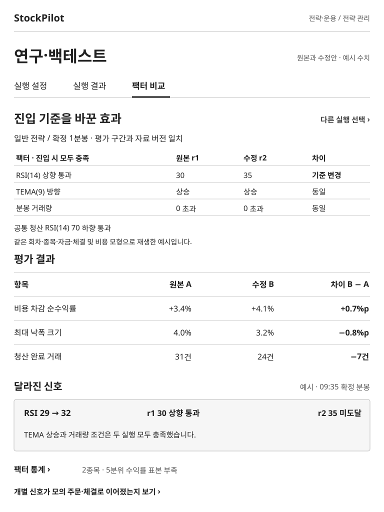

# StockPilot 팩터 연구와 백테스트 설계

StockPilot의 초기 운용 전략은 0개다. 투자자는 공개 프로젝트의 구현과 본인이 학습한 자료를 바탕으로 연구 후보를 구성한다. 오픈소스 백테스터로 국내 자료를 재생하고 결과를 비교한 뒤, 어떤 규칙과 설정을 운용 전략으로 만들지 정한다. AI는 출처와 실험 결과를 읽고 차이와 위험을 설명한다. [화면 정의서](<화면 정의서.md#ui-006>) · [운용 규칙](<전략·운용 규칙서.md>)

## 네 프로젝트에서 가져올 설계

2026-11-27에 공개 예제와 공식 화면 자료를 검토했다. 웹 앱, 클라우드 제품 화면, 노트북 출력은 제공 형태가 달라 적용 방식도 다르다.

| 프로젝트 | 실제 팩터·규칙 | 공개 화면에서 확인한 구성 | StockPilot에 적용할 부분 |
| --- | --- | --- | --- |
| FreqUI | 지표는 연결된 Freqtrade 전략이 공급한다. 공식 샘플의 매수 조건은 RSI 기준선 상향 돌파, TEMA의 상승과 볼린저 중앙선 대비 위치, 양수 거래량을 함께 확인한다. | 백테스트 폼에 전략·봉 주기·시작 자금·기간을 두고, 이전 실행을 불러와 결과를 비교한다. 차트에 올릴 지표도 고를 수 있다. | 실행 폼에는 전략 버전에 등록한 입력만 노출한다. 거래를 열면 당시 참·거짓이었던 조건과 임계선을 함께 표시한다. 전략 소스와 UI 코드는 각각 별도로 검토한다. [공식 화면](https://www.freqtrade.io/en/stable/freq-ui/#backtesting) · [샘플 전략](https://github.com/freqtrade/freqtrade/blob/develop/freqtrade/templates/sample_strategy.py) |
| Alphalens Reloaded | 장중 예제는 시가와 전일 종가의 차이를 전일 종가로 나눈 갭으로 종목 순위를 매긴다. 관측 시각, 진입 가격, 이후 수익률의 끝 시각을 맞추는 과정을 보여 준다. | Jupyter에서 수익률·정보계수·회전율 분석표를 생성한다. 공개 노트북의 계산식과 출력 호출을 확인했다. | 같은 시각의 지정 종목을 묶어 분위별 이후 수익률과 순위 상관을 계산한다. 표본 수와 제외 건수를 결과 옆에 둔다. 분석 함수의 국내 분봉 입력 호환성을 먼저 시험한다. [장중 팩터 예제](https://github.com/stefan-jansen/alphalens-reloaded/blob/main/src/alphalens/examples/intraday_factor.ipynb) · [분석표 예제](https://github.com/stefan-jansen/alphalens-reloaded#example-tear-sheets) |
| QuantConnect LEAN | ETF 순환 예제는 일봉 30개와 90개의 가격 모멘텀을 100 대 75로 가중해 순위를 계산하고 보유 종목의 교체 또는 현금 보유를 판단한다. | QuantConnect Cloud 결과 화면은 자산 곡선과 낙폭을 보여 준다. 주문 행을 펼치면 접수·부분 체결·취소 이벤트를 보고, 종목 차트에서 주문 위치를 확인할 수 있다. | LEAN 소스에서는 신호와 주문 처리 경계를 참고한다. 클라우드 화면에서는 거래 상세의 탐색 방식을 참고해 StockPilot 모의 원장의 이벤트를 표시한다. [전략 코드](https://github.com/QuantConnect/Lean/blob/master/Algorithm.Python/ETFGlobalRotationAlgorithm.py) · [클라우드 결과 화면](https://www.quantconnect.com/docs/v2/cloud-platform/backtesting/results) |
| Microsoft Qlib | Alpha158에는 과거 종가와 현재 종가의 비율(ROC), 종가 표준편차를 현재 종가로 나눈 값(STD), 평균 거래량을 현재 거래량으로 나눈 값(VMA)이 있다. 실험 설정은 학습·검증·시험 기간과 비용을 분리한다. | 분석 리포트는 같은 시간축에 기준 지수와 비용 차감 전후 성과, 낙폭을 배치한다. 점수와 이후 수익률의 순위 상관 그래프도 제공한다. | 팩터의 입력·식·기간과 실행 조건을 버전으로 고정한다. 차트의 비용 전후 비교를 가져오되 계좌 수익률과 낙폭은 모의 순자산에서 계산한다. [Alpha158 계산식](https://github.com/microsoft/qlib/blob/main/qlib/contrib/data/loader.py) · [실험 설정](https://github.com/microsoft/qlib/blob/main/examples/benchmarks/LightGBM/workflow_config_lightgbm_Alpha158.yaml) · [공식 리포트](https://qlib.readthedocs.io/en/latest/component/report.html) |

## 연구 후보에서 운용 전략까지

후보에 연결할 공개 팩터의 계산식·단위·설정값과 개인 연구 팩터 등록 양식은 [팩터 정의서](<팩터 정의서.md>)에서 관리한다.

1. **자료를 고른다.** 공개 저장소의 예제 전략을 가져오거나, 공개 팩터와 본인이 학습한 규칙을 조합한다. 저장소·커밋·파일 경로, 참조한 학습 자료, 국내 적용을 위해 변경한 점을 후보에 기록한다. 아래 네 프로젝트는 선택 가능한 연구 자원이다. 첫 실행에서 선택된 후보는 없다.
2. **실행할 후보를 만든다.** 투자자가 팩터, 진입·청산 규칙, 수량 규칙과 적용 주기를 정한다. 예를 들어 Qlib에서 가격 팩터 하나를 가져오면 우선 Alphalens로 이후 수익률과의 관계를 살펴볼 수 있다. 거래를 재생하려면 진입·청산과 수량 규칙까지 정해 후보 리비전에 저장한다. 연구용 버전은 미검증 상태에서 시작한다.
3. **오픈소스 백테스터를 실행한다.** 후보의 입력 주기·주문 방식을 지원하는 엔진을 선택하고 버전을 기록한다. LEAN 전략은 LEAN 재생을, 진입·청산 신호 배열은 vectorbt 재생을 검토한다. 서로 다른 엔진으로 옮길 때는 같은 고정 입력에서 신호·체결·비용이 맞는지 대조한다. 후보가 요구하는 시세 자료를 매핑하고 실제 회차에서 알 수 있었던 자료만 읽는다.
4. **비교하고 수정한다.** 연구 구간에서 원본과 수정안을 같은 종목·기간·자금·비용·체결 모형으로 재생한다. 수익률·낙폭·거래 수와 거래별 원인을 대조한다. 투자자가 선택한 후보의 규칙을 고정하고, 연구에 쓰지 않은 기간과 사전 기준으로 정식 검증한다. 규칙이나 파라미터 변경은 새 리비전에서 다시 검증한다.
5. **운용 버전을 정한다.** 투자자가 통과 결과를 보고 채택하면 해당 리비전, 원본 출처와 실행 ID를 그대로 연결한다. 채택된 버전을 계좌·종목·금액과 오전·오후·장 마감 전 회차에 배정할 수 있다. 미달 후보도 실험 기록과 함께 보관한다.

## 평가 방식과 백테스트 재생

전략 버전에 평가 시점과 필요한 시세 종류를 고정한다. 일반 전략은 Celery가 1분마다 확정 분봉으로 평가한다. 실시간 시세 WebSocket은 단타 전략에만 사용한다. 오전·오후·장 마감 전은 전략을 시작하는 회차다. 시작한 전략의 평가 빈도는 해당 버전이 정한다.

| 평가 방식 | 실운용 | 같은 버전의 백테스트 |
| --- | --- | --- |
| 확정 1분봉 | Celery가 지정 N개 종목에서 직전 확정 봉을 확인한다. 전략·배정·종목·봉 종료 시각으로 중복 평가를 막고 실제 수신·평가 지연을 기록한다. | 과거 봉이 이용 가능해진 시각마다 같은 평가 함수를 호출한다. 주문 가능 시각은 자료 수신과 평가 이후다. 다음 봉 시가는 당시 주문이 도달할 수 있을 때만 체결가 근사에 쓴다. |
| 실시간 이벤트 · 단타 필수 | 구독이 승인된 종목의 체결 틱 또는 호가 갱신을 수신 순서대로 전달한다. 버전에서 평가를 일으키는 이벤트 종류를 지정한다. | 저장한 체결 틱과 필요한 호가를 당시 수신 순서로 재생한다. 주문 도달 지연, 매수·매도 호가 차이와 체결 가능 수량을 모형에 반영한다. 호가 대기 순번처럼 관측할 수 없는 값은 체결 가정으로 기록한다. |

가격 수신·과거 재생 어댑터가 같은 형식으로 시장 이벤트를 전달하고, 전략과 주문 상태 계산은 실운용과 재생에서 공유한다. 백테스트는 가상 시계와 모의 체결을 쓴다. 오픈소스 엔진을 고를 때 봉 종료 콜백, 틱·호가 이벤트 순서, 주문 시점과 체결 모형을 확장할 수 있는지 확인한다. 평가 방식을 바꾸면 새 버전으로 정식 검증한다. 실시간 버전에 필요한 과거 데이터가 없으면 해당 종목의 이벤트를 수집해 재생 이력을 쌓고, 충분한 표본이 생길 때까지 미판정으로 둔다.

**재생기 검수.** 같은 종목·기간의 틱 원본으로 확정 1분봉도 생성한다. 동일한 규칙·자금·비용·모의 체결기에서 평가 시점만 바꿔 최초 신호 시각, 한쪽에서만 발생한 신호, 모의 체결가, 비용 차감 손익을 비교한다. 미니PC에서는 분 단위 수집·평가가 다음 분 전에 끝나는지와 실시간 이벤트 지연의 95백분위·누락 구간을 측정한다. 구독 한도 초과 또는 연결 단절 구간은 실시간 평가 대기·중단으로 기록한다. [증권사별 구독 한도](<기술 스택.md>)

## 화면과 실행 기록

| UI-006에서 하는 일 | 처음 보이는 정보 | 선택 후 보이는 근거 |
| --- | --- | --- |
| 실행 설정 | 원본 출처·후보 리비전·백테스터, 지정 종목 수·배정액, 진입·청산 조건, 연구·평가 기간 | 팩터 행에서 계산식과 기준 시각, 누락 구간, 자료·비용·체결 모형 버전을 확인한다. |
| 팩터 비교 | 두 리비전의 전체 팩터 목록·조합식·변경 항목, 공통 재생 조건, 비용 차감 순수익률·낙폭·완료 거래 수의 차이 | 팩터별 종목 순위 및 이후 수익률, 순위 상관, 유효 표본, 제외 사유를 연다. 거래 행을 누르면 해당 신호 시각의 분봉·임계값·잔여 현금을 본다. |
| 실행 결과 | 실행 목적(연구·최초·주간·수동 재검증), 판정 항목·기준·실측값, 다음 만료 시각 | 주문별 신호·모의 접수·부분 체결·취소와 비용을 KST 순서로 본다. 주간 결과에서 직전 실행을 골라 같은 버전의 평가 기간·표본·비용 차감 후 성과 변화와 판정 변경 사유를 확인한다. |

주간 비교에서는 기간이 이동했음을 표시한다. 자료·비용·체결 모형 또는 기준 버전까지 달라졌다면 변경 항목을 노출하고, 같은 조건으로 다시 실행한 두 결과에서만 팩터 효과를 비교한다. 전략 카드의 ‘버전·검증 이력’ 상세 레이아웃은 화면 개발 시 수정한다.

한 후보 리비전에는 여러 팩터 정의와 진입·청산 조합식을 함께 저장한다. 각 신호에 개별 팩터의 측정값·조건 충족 여부와 최종 조합 결과를 연결한다. 특정 팩터의 추가 효과를 조사할 때는 그 항목만 바꾼 실행을 같은 데이터와 비용으로 비교한다.

**서버 흐름.** UI-006에서 실행을 요청하면 서버가 조건을 고정하고 실행 ID를 반환한다. 백그라운드 작업은 해당 버전에 맞춰 확정 분봉 또는 체결·호가 이벤트를 재생한다. 회차는 전략 시작을 뜻하며, 다음 회차가 시작된 뒤에도 기존 전략의 유효한 조건을 추적한다. 하나의 자료 버전과 팩터 버전으로 계산한 값은 A와 B에서 재사용한다. 신호 계산, 배정액·현금 확인, 모의 주문과 체결, 결과 집계를 순서대로 기록한다. 키움·한투의 실주문 전송과 모의 재생은 실행 경로를 분리한다.

| 보존할 기록 | 다시 답할 수 있는 질문 |
| --- | --- |
| 실행 ID, 비교 쌍 ID, 원본 참조, 후보 리비전, 전략·팩터·기준 버전, 목적, 평가 방식, 입력 이벤트 종류, 엔진·체결 모형 버전, 자료·비용 스냅샷, 종목별 배정, 기간과 회차 | 지난주와 달라진 입력은 무엇인가? 동일 조건에서 결과를 재현할 수 있는가? |
| 종목·관측 시각·이용 가능 시각별 팩터값, 결측 사유, 조건별 통과 여부, 신호 ID | 09:35에 어느 자료로 매수를 판단했는가? B에서 제외한 이유는 무엇인가? |
| 신호에 연결한 모의 주문·체결 이벤트, 잔여 현금·수량, 순자산, 기준 전략 결과, 표본과 판정 | 어떤 신호가 실제로 모의 체결됐는가? 비용 차감 후에도 기준을 충족했는가? |

AI는 고정된 실행 ID와 계산 결과를 읽어 해석한다. 최초 연구 비교에서는 양쪽에 같은 수량 규칙을 사용한다. 실제 AI 수량 판단을 복기하는 실험은 당시 저장한 모델 답변과 입력이 있는 경우에 구분해 표시한다. 연구용 A/B 실행은 자동매매 가능 상태를 변경하지 않는다. 투자자의 채택 결정과 정식 검증 판정을 각각 보존한다. 신규 실주문에는 채택과 유효한 통과 판정이 모두 필요하며 미달·만료·재개는 기존 운용 규칙을 따른다.

## 개발 순서와 확인 사례

1. **빈 상태에서 시작한다.** 운용 전략이 0개여도 공개 예제 또는 학습 자료에서 후보를 등록해 연구를 실행할 수 있다. 출처와 리비전으로 동일 입력의 신호·거래를 재현한다.
2. **후보 둘을 비교한다.** 한 후보의 설정 하나를 바꾸면 새 리비전과 실행 ID가 생긴다. 수정안이 연구 구간에서 높은 수익을 내도 정식 검증과 채택 전에는 회차 배정 목록에 나타나지 않는다.

3. **주간 실행을 연결한다.** 고정 버전의 평가 창만 옮겨 직전 결과와 비교한다. 기준 미달이면 신규 주문이 보류되고, 자료 부족·실패 시에는 기존 유효 기한이 늘어나지 않아야 한다. 같은 주간 작업의 재시도로 판정이 중복 적용되지 않는지 확인한다.

첫 구현은 기존 백테스트 엔진 후보 한 개로 재생하고 Alphalens의 진단 결과를 별도로 대조한다. FreqUI와 QuantConnect Cloud는 화면 참고, Qlib은 계산식과 실험 설정 참고로 사용한다. 미니PC에서 지정 종목 수·평가 창별 소요 시간과 최대 메모리를 측정한 뒤 적용 범위를 정한다. 투자자가 정할 값은 평가 창, 기준 대비 최소 순수익률, 최대 허용 낙폭, 최소 거래·팩터 표본, 주간 마감 시각이다.
