# StockPilot 화면 정의서

**v0.12 · 화면별 설계 초안.** 네 상위 메뉴와 공통 로그인을 화면 단위로 정의한다. 화면 번호를 선택하면 메뉴 경로, 연결 API, 배치 예시, 기능표를 볼 수 있다. 그림은 태블릿 세로(768×1024) 기준의 정적 예시다. 계좌·거래·모델 값은 예시 데이터다.

## 화면 목록

| 화면 번호 | 상위 메뉴 | 화면 메뉴명 |
| --- | --- | --- |
| [UI-001](#ui-001) | 공통 | [로그인](#ui-001) |
| [UI-002](#ui-002) | 홈 | [전체 계좌 요약](#ui-002) |
| [UI-026](#ui-026) | 홈 | [전체 계좌 요약 → 달력 날짜 선택 → 일일 일지](#ui-026) |
| [UI-003](#ui-003) | 홈 | [계좌 대시보드](#ui-003) |
| [UI-004](#ui-004) | 전략·운용 | [오늘의 전략 운용](#ui-004) |
| [UI-005](#ui-005) | 전략·운용 | [전략 관리 → 전략 목록](#ui-005) |
| [UI-006](#ui-006) | 전략·운용 | [전략 관리 → 연구·백테스트](#ui-006) |
| [UI-007](#ui-007) | 전략·운용 | [회차 관리 → 전략 배정](#ui-007) |
| [UI-008](#ui-008) | 전략·운용 | [회차 관리 → 실행 이력](#ui-008) |
| [UI-009](#ui-009) | 전략·운용 | [회차 관리 → 회차 상세](#ui-009) |
| [UI-010](#ui-010) | 전략·운용 | [회차 관리 → 과거 회차 재생](#ui-010) |
| [UI-011](#ui-011) | 전략·운용 | [종목·시장 분석](#ui-011) |
| [UI-012](#ui-012) | 전략·운용 | [종목·시장 분석 → 관심종목](#ui-012) |
| [UI-013](#ui-013) | 거래·리포트 | [주문·체결 이력](#ui-013) |
| [UI-014](#ui-014) | 거래·리포트 | [주문·체결 이력 → 주문 상세](#ui-014) |
| [UI-015](#ui-015) | 거래·리포트 | [주간 운용 리포트](#ui-015) |
| [UI-016](#ui-016) | 거래·리포트 | [손익·체결가 분석 → 매매 방식별 실현손익](#ui-016) |
| [UI-017](#ui-017) | 거래·리포트 | [손익·체결가 분석 → 종목별 평가손익](#ui-017) |
| [UI-018](#ui-018) | 거래·리포트 | [손익·체결가 분석 → 체결가 분석](#ui-018) |
| [UI-019](#ui-019) | 거래·리포트 | [매매일지](#ui-019) |
| [UI-020](#ui-020) | 설정 | [계좌 연결·API 키](#ui-020) |
| [UI-021](#ui-021) | 설정 | [계좌별 운용 설정](#ui-021) |
| [UI-022](#ui-022) | 설정 | [AI 모델·수량 기준](#ui-022) |
| [UI-023](#ui-023) | 설정 | [주간 목표](#ui-023) |
| [UI-024](#ui-024) | 설정 | [알림 채널](#ui-024) |
| [UI-025](#ui-025) | 설정 | [감사 로그](#ui-025) |

## 종목별 운용 항목

**전략 버전**은 재사용하는 규칙이다. **운용 항목**은 선택 계좌·거래일·시작 회차에 그 규칙을 한 종목과 배정 금액에 연결한 한 건이다. 예를 들어 오전에 채택한 예시 전략 A를 삼성전자에 100만 원, 현대차에 50만 원 배정하면 운용 항목이 두 건 생긴다. 각 항목은 고유한 배정 ID로 평가·판단·주문과 연결된다. 금액은 이 시안에서 항목별 매수 운용 한도(원)로 해석한다. 실제 주문 금액과 체결 금액은 별도 표시한다.

[전략 배정](#ui-007)에서 종목과 금액 입력 → [오늘의 전략 운용](#ui-004)에서 배정별 상태 확인 → [회차 상세](#ui-009)에서 선택한 배정의 판단 확인 → [주문 상세](#ui-014)에서 개별 주문·체결 확인.

## 계좌에서 주문 상세까지

홈 메뉴에서 계좌 대시보드를 열고 계좌를 선택하면 주문 상세까지 같은 계좌를 유지한다. 로그인 후 공통 메뉴에서 로그아웃하면 IF-002로 현재 세션을 종료한다. 로그인 외 화면은 WireGuard 연결과 유효한 로컬 세션이 필요하다. 계좌별 데이터는 서버가 소유 관계를 확인한다.

화면 API에는 호출 방식과 경로를 표시한다. 서버 내부 처리와 외부 채널 전송은 구분하며, IF 번호를 누르면 송수신 주체와 필드를 확인할 수 있다. **추가 설계** 항목은 화면을 구현할 때 합의해야 할 계약 제안이다.

## 화면 크기에 따른 배치

| 영역 | 태블릿 세로 | 넓은 화면 |
| --- | --- | --- |
| 탐색 | 상단 메뉴에서 홈, 전략·운용, 거래·리포트, 설정을 연다. | 승인된 데스크톱 대시보드의 흰색 헤더에는 대시보드·포트폴리오·매매일지 탭을 둔다. |
| 계좌와 기준 시각 | 상단에 선택 계좌를 표시하고 바로 아래에 데이터 기준 시각을 둔다. | 본문 상단에 계좌 선택과 기준 시각을 유지한다. |
| 전체 계좌 요약 | 상단을 같은 너비의 두 칸으로 나눈다. 왼쪽은 총자산 추이, 오른쪽은 이번 주 운용 성과다. 두 칸의 크기는 각각 352×208px이다. 아래에는 진행 중인 전략과 손익 달력을 차례로 표시한다. | 총 평가자산·오늘 실현손익·주간 수익률 추이를 첫 줄에 둔다. 아래에는 보유 종목과 월별 수익 캘린더, 마지막에는 최근 체결 내역을 표시한다. [승인된 데스크톱 규격](<UI 디자인 가이드.md>) |
| 계좌 대시보드 | 계좌 상태 → 확인할 일 → 금액 → 진행 중인 전략 → 최근 주문 → 보유 종목 순으로 읽는다. | 왼쪽에 금액·진행 중인 전략·보유 종목을, 오른쪽에 확인할 주문과 최근 주문을 둔다. |
| 주문 목록과 상세 | 목록 행을 누르면 상세가 본문 전체에 열린다. ‘주문 목록으로’는 기존 계좌·필터·스크롤 위치로 돌아간다. | 목록과 상세의 필수 열이 함께 보이면 좌우로 배치한다. 공간이 부족하면 태블릿 세로 방식을 쓴다. |

## UI-001

**화면 메뉴명**　공통 → 로그인

WireGuard 접속 후 전용 로컬 계정으로 로그인한다.

**API**

| 구분 | 인터페이스 | 호출 방식·경로 |
| --- | --- | --- |
| 화면 API | [IF-001 로컬 계정 로그인](<인터페이스 정의서.md#if-001>) | `POST /sessions` |

**화면 구성 예시**

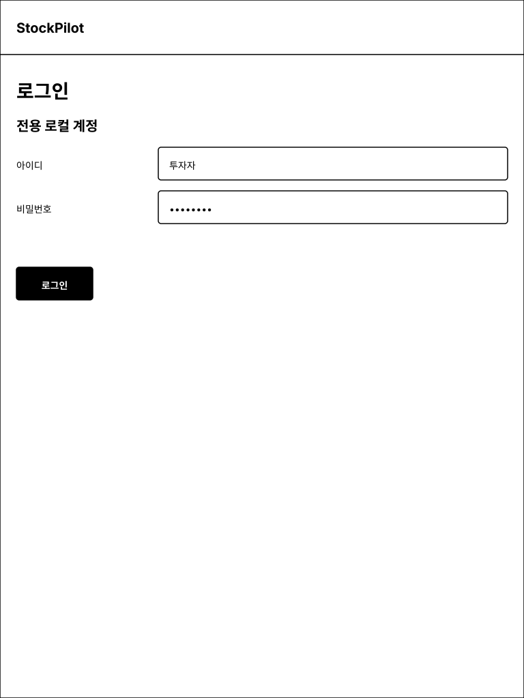

**기능표**

| 기능 | 사용자 동작 | 표시 결과·예외 | 기능 ID |
| --- | --- | --- | --- |
| 로그인 | 아이디와 비밀번호를 제출한다. | 인증되면 전체 계좌 요약을 연다. 실패하면 아이디 존재 여부를 드러내지 않는다. | F-001 |
| 세션 만료 | 만료된 세션으로 화면을 요청한다. | 로그인 화면으로 이동한다. VPN 연결 전에는 로그인 화면 자체에 접근할 수 없다. | F-001 |

[화면 목록으로](#화면-목록)

## UI-002

**화면 메뉴명**　홈 → 전체 계좌 요약

로그인 직후 열리는 메인 대시보드다. 본인이 연결한 전체 계좌의 자산 변화와 현재 진행 중인 전략을 확인한다. 달력에서 날짜를 누르면 [그날의 일지](#ui-026)가 열린다. 자동매매를 꺼 둔 계좌도 합산한다.

**API**

| 구분 | 인터페이스 | 호출 방식·경로 |
| --- | --- | --- |
| 화면 API | [IF-003 계좌 목록 조회](<인터페이스 정의서.md#if-003>), [IF-052 포트폴리오 조회](<인터페이스 정의서.md#if-052>) | `GET /accounts`, `GET /portfolio?account_ids=…` |
| 화면 API | [IF-014 주간 성과 조회](<인터페이스 정의서.md#if-014>) | `GET /reports/weekly/{week}?account_ids=…` |
| 추가 설계 | 월별 일자 집계. 거래일, 마감 총자산, 일일 손익, 집계 상태, 기준 시각을 반환한다. 차트와 달력이 같은 결과를 사용한다. | `GET /portfolio/daily?month=YYYY-MM` |
| 추가 설계 | 해당 월에 본인이 일지를 저장한 날짜 목록을 반환한다. 휴장일 기록도 포함한다. | `GET /journal/days?month=YYYY-MM` |
| 추가 설계 | 본인 계좌의 당일 전략과 추적 중인 주문을 조회한다. 계좌·시작 회차·전략 버전·종목·방향·조건 또는 대기 사유·기준 시각을 제공한다. 주문이 있으면 주문 ID와 확인된 체결량·잔량을 포함한다. [IF-026](<인터페이스 정의서.md#if-026>)은 회차 이력, [IF-065](<인터페이스 정의서.md#if-065>)는 계좌별 시세 감시 상세에서 사용한다. | `GET /portfolio/active-strategies` |
| 화면 API | [IF-002 로그아웃](<인터페이스 정의서.md#if-002>) | `DELETE /sessions/current` |

**화면 구성 예시**

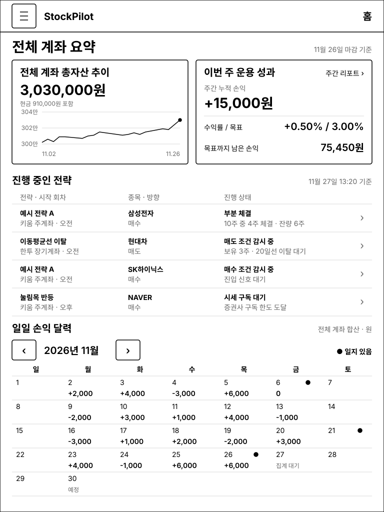

**기능표**

| 기능 | 사용자 동작 | 표시 결과·예외 | 기능 ID |
| --- | --- | --- | --- |
| 전체 계좌 총자산 추이 | 홈을 열거나 달력의 월을 바꾼다. | 선택 월의 거래일별 마감 총자산(현금과 보유 종목 평가액의 합)을 원화로 그린다. 입출금은 자산에 반영한다. 일부 계좌의 마감 자료가 누락된 날은 선을 끊고 집계 대기로 표시한다. | F-069 확장안 |
| 이번 주 운용 성과 | 홈에서 이번 주 누적 손익을 확인하고 [주간 리포트](#ui-015)를 연다. | 최근 집계 기준으로 외부 입출금을 제외한 손익과 실제·목표 수익률을 표시한다. 남은 손익은 주초 자산에 해당 주 목표율을 곱한 금액에서 누적 손익을 뺀다. 목표에 도달하면 ‘목표 달성’, 이번 주 집계 전에는 ‘집계 대기’로 표시한다. 달력에서 다른 달을 열어도 현재 주를 유지한다. | F-077, F-078, F-079, F-080 |
| 일일 손익 달력 | 이전·다음 달을 열거나 날짜를 선택한다. | 각 거래일 칸에 전체 계좌 합산 손익을 부호와 원 단위로 표시한다. 확정 손익 0원, 집계 대기, 휴장일, 미래 거래일을 구분한다. | 신규 제안 |
| 작성일 표시·이동 | 달력에서 날짜 칸을 누른다. | 일지가 있는 날에 ●를 표시한다. 범례와 날짜의 읽기용 이름에 ‘일지 있음’을 포함한다. 날짜를 선택하면 [일일 일지](#ui-026)를 연다. | 신규 제안 |
| 전략 진행 현황 | 현재 어떤 종목을 왜 감시하거나 기다리는지 확인한다. | 계좌·시작 회차·전략·종목·매매 방향별로 표시한다. 다음 회차가 시작돼도 유효한 조건과 미완료 주문을 유지한다. 달력의 조회 월과 독립적으로 최신 상태와 기준 시각을 표시한다. | F-028, F-089 확장안 |
| 조건 감시·보류 사유 | 매수·매도 조건이나 대기 행을 누른다. | 감시 중이면 충족을 기다리는 조건을, 대기·중단이면 구독 한도나 시세 단절 등 사유를 표시한다. 행을 누르면 해당 계좌의 [오늘의 전략 운용](#ui-004)을 연다. 최종 주문 검증에서 보류했으면 사유와 [회차 상세](#ui-009)를 연결한다. | F-101, F-089 확장안 |
| 진행 중인 주문 | 주문이 연결된 행을 누른다. | 접수 확인 중, 미체결, 부분 체결, 취소 확인 중 등 최신 상태를 표시한다. 부분 체결에는 확인된 체결량과 잔량을 표시하고 [주문 상세](#ui-014)를 연결한다. 조회 실패 시 마지막 확인 시각을 보여준다. 조회가 성공했고 진행 항목이 없으면 ‘현재 진행 중인 전략이 없습니다’를 표시한다. | F-098 확장안 |
| 로그아웃 | 공통 메뉴에서 로그아웃한다. | 현재 세션을 종료하고 로그인으로 이동한다. | F-002 |

**주간 성과 예시.** 주초 운용 자산 3,015,000원의 3%는 90,450원이다. 11월 23~26일 누적 손익은 +15,000원이므로 실제 수익률은 +0.50%(반올림), 목표까지 남은 손익은 75,450원이다.

**시안의 손익 기준.** 전 거래일 마감 대비 총자산 변동액에서 당일 외부 순입금(입금 − 출금)을 뺀다. 개인 매매와 자동매매의 실현손익 및 보유 종목의 평가 변동을 포함한다. 예를 들어 10만 원을 입금하고 다른 변동이 없으면 차트의 자산은 10만 원 늘고 달력에는 0원이 표시된다. 이 기준은 검토 중이다.

[화면 목록으로](#화면-목록)

## UI-003

**화면 메뉴명**　홈 → 계좌 대시보드

선택 계좌의 자산, 감시 상태와 확인할 주문을 한눈에 본다.

**API**

| 구분 | 인터페이스 | 호출 방식·경로 |
| --- | --- | --- |
| 화면 API | [IF-004 계좌 상세 조회](<인터페이스 정의서.md#if-004>) | `GET /accounts/{account_id}` |
| 화면 API | [IF-009 계좌 운용 설정 조회](<인터페이스 정의서.md#if-009>) | `GET /accounts/{account_id}/settings` |
| 화면 API | [IF-017 주문 이력 조회](<인터페이스 정의서.md#if-017>) | `GET /accounts/{account_id}/orders` |
| 화면 API | [IF-019 잔고 재동기화 요청](<인터페이스 정의서.md#if-019>) | `POST /accounts/{account_id}/sync-runs` |
| 화면 API | [IF-020 재동기화 결과 조회](<인터페이스 정의서.md#if-020>) | `GET /accounts/{account_id}/sync-runs/{sync_run_id}` |
| 화면 API | [IF-026 회차 실행 이력](<인터페이스 정의서.md#if-026>) | `GET /accounts/{account_id}/sessions` |
| 화면 API | [IF-065 실시간 감시 현황 조회](<인터페이스 정의서.md#if-065>) | `GET /accounts/{account_id}/monitoring` |

**화면 구성 예시**

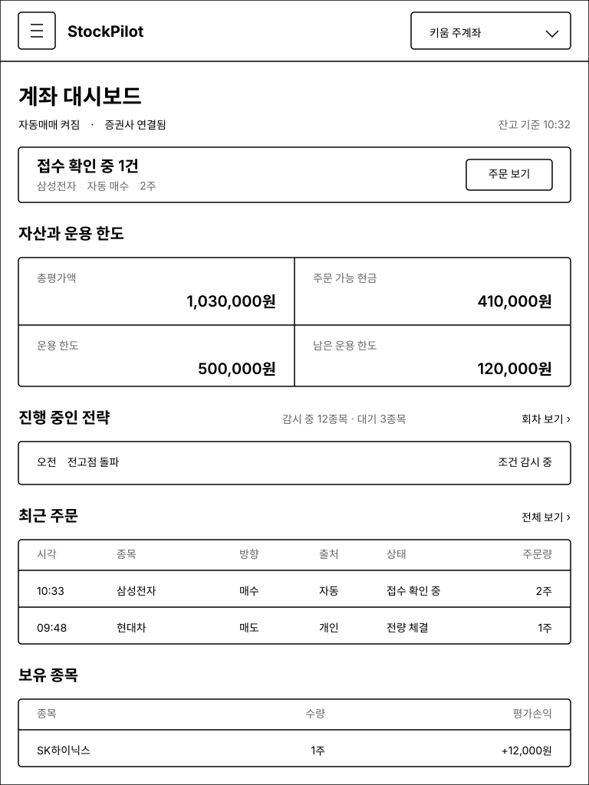

**기능표**

| 기능 | 사용자 동작 | 표시 결과·예외 | 기능 ID |
| --- | --- | --- | --- |
| 계좌 선택·한도 | 계좌를 전환한다. | 별칭·기준 시각·자동매매 상태·현금·보유와 운용 한도를 새로 조회한다. | F-097, F-026 |
| 확인할 주문 | 접수 확인 중인 주문을 선택한다. | 해당 주문 상세를 연다. 수량 미확인은 0주와 구분한다. | F-098 |
| 감시·회차 | 감시 건수 또는 회차 보기를 선택한다. | 오늘의 전략 운용 또는 회차 실행 이력에서 해당 종목 배정의 대기 사유와 판단을 확인한다. | F-101, F-089 |
| 재동기화 | 조회 실패 안내에서 재동기화를 요청한다. | 완료 전까지 마지막 성공 시각을 유지하고 결과를 다시 조회한다. | F-090 |

[화면 목록으로](#화면-목록)

## UI-004

**화면 메뉴명**　전략·운용 → 오늘의 전략 운용

선택한 계좌의 오늘 배정을 한 줄에 한 건씩 표시한다. 전략 이름이 같아도 종목·배정 금액·마지막 평가·주문 상태는 독립적이다. 시작 전인 항목도 대상 종목과 배정 금액을 보여준다. 같은 종목에 여러 전략이 걸리면 시세 수집은 공유하고, 평가는 배정별로 기록한다.

**API**

| 구분 | 인터페이스 | 화면에 필요한 값 |
| --- | --- | --- |
| 추가 설계 | 계좌·거래일별 운용 항목 조회 | 배정 ID, 시작 회차, 전략 버전, 종목, 배정 금액, 평가 방식, 상태·사유, 기준 자료 시각, 마지막 평가 시각, 판단·주문 참조 |
| 보조 정보 | [IF-065 감시 현황](<인터페이스 정의서.md#if-065>) | 단타 구독 대기·중단 및 계좌 체결 통보 연결 상태. 기본 1분 평가 항목은 최근 수집한 분봉과 평가 결과로 표시한다. |

| 기능 | 사용자 동작 | 표시 결과·예외 |
| --- | --- | --- |
| 배정 찾기 | 계좌·시작 회차를 선택한다. | 기본 목록은 오늘의 모든 회차를 포함한다. 오후에도 유효한 오전 배정은 오전 표시를 유지한다. 배정이 없으면 전략 배정으로 이동한다. |
| 상태 읽기 | 운용 항목을 선택한다. | 선택한 종목의 기준 자료·평가 시각과 신호 사유를 보여준다. 평가 전, 평가 완료·신호 없음, 자료 지연·평가 보류를 구분한다. 수집 장치의 연결 정보는 사유를 펼칠 때 표시한다. |
| 판단·주문 추적 | 판단 또는 주문을 선택한다. | 같은 배정 ID의 상세만 연다. 주문이 없으면 최근 평가 사유를 표시한다. |

[화면 목록으로](#화면-목록)

## UI-005

**화면 메뉴명**　전략·운용 → 전략 관리 → 전략 목록

처음에는 빈 목록과 ‘전략 연구 시작’을 표시한다. 아래 카드는 연구와 채택 이후의 상태를 설명하는 예시다. 한 전략에 카드 한 장을 표시한다. 카드의 짧은 설명과 신호 예시 그림은 매매 규칙이 포착하는 움직임을 설명한다. 그림은 예시 가격 경로이며 백테스트 성과는 별도로 표시한다. 종목별 배정 금액과 실주문은 [오늘의 전략 운용](#ui-004)에서 확인한다.

태블릿 세로(768px)에서 좌우 여백 24px, 열 간격 16px로 두 카드를 나란히 놓는다. 예시 카드 크기는 352×216px다. 신호 그림 옆에 판정 요약을 두고 하단에는 이력과 배정·재검증 동작을 둔다. 카드 두 장의 본문 폭을 확보할 수 없는 화면에서는 한 열로 바꾼다. 긴 전략명이나 큰 글자 설정에서는 카드 높이를 늘린다.

**카드에 표시할 내용**

| 영역 | 표시 내용 |
| --- | --- |
| 전략 이해 | 이름, 한 문장 설명, 기준선·진입 지점을 표시한 신호 예시와 대체 설명 |
| 적용 버전 | 자동매매 가능 여부와 그 판정의 버전. 운용 중인 v2와 연구 중인 v3가 함께 있으면 각각 표시한다. 최신 버전을 등록해도 기존 배정의 버전은 유지된다. |
| 검증 근거 | 최근 최초·주간 검증일, 통과 항목 수/필수 항목 수, 첫 미달 사유, 다음 검증 예정일. 미검증·자료 부족·실행 오류는 별도 상태로 표시한다. |
| 이동 | 카드의 ‘버전·검증 이력’에서 버전별 결과와 변경점을 조회한다. 운용 가능한 버전은 ‘종목 배정’, 미달·만료 버전은 ‘재검증’으로 연결한다. 배정만으로 주문은 발생하지 않는다. |

**버전·검증 이력**은 목록에서 연 전략의 상세 화면이다. 버전별 변경점, 최초 검증과 매주 재검증한 시각, 평가 기간·자료·비용·기준 버전, 항목별 기준값·측정값·통과 여부, 그 결과로 바뀐 사용 가능 여부를 남긴다. 실행 실패와 미실행도 구분한다. 보관한 버전에서 재검증하면 같은 버전에 실행 기록이 추가된다. 규칙·파라미터 변경은 새 버전에서 다시 검증한다.

버전·검증 이력의 레이아웃은 화면 개발 시 수정한다.

**API** · [IF-054](<인터페이스 정의서.md#if-054>)는 버전 등록, [IF-055](<인터페이스 정의서.md#if-055>)는 투자자의 채택·보류 기록이다. 화면 확장안은 전략별 카드 조회, 버전별 검증 실행 이력과 항목별 결과 조회다. 자동매매 적격성은 서버가 최신 유효 검증으로 계산한다.

[화면 목록으로](#화면-목록)

## UI-006

**화면 메뉴명**　전략·운용 → 전략 관리 → 연구·백테스트

운용 전략이 없어도 시작할 수 있다. 투자자가 공개 소스와 학습 자료를 선택해 연구 후보를 만들고, 오픈소스 백테스터에서 국내 자료로 모의 거래를 재생한다. 결과에서 거래 한 건을 열어 당시 팩터값과 모의 체결을 대조한다. 계산 엔진과 UI의 재사용 후보는 [개발 참고 저장소](<개발 참고 저장소.md#백테스트-엔진과-화면>)에 정리했다.

**API**

| 구분 | 인터페이스 | 호출 방식·경로 |
| --- | --- | --- |
| 화면 API | [IF-054 전략 버전 등록](<인터페이스 정의서.md#if-054>) | `POST /strategies/versions` |
| 서버 내부 | [IF-034 백테스트 실행·성과 비교](<인터페이스 정의서.md#if-034>) | `내부 실행 명령` |
| 서버 내부 | [IF-053 전략 연구 보조](<인터페이스 정의서.md#if-053>) | `내부 연구 요청` |
| 추가 설계 | 연구 보조·백테스트 실행 및 결과 조회를 요청하는 화면 API | `POST /strategy-research` · `POST /backtests` · `GET /backtests/{id}` |

**화면 구성 예시**

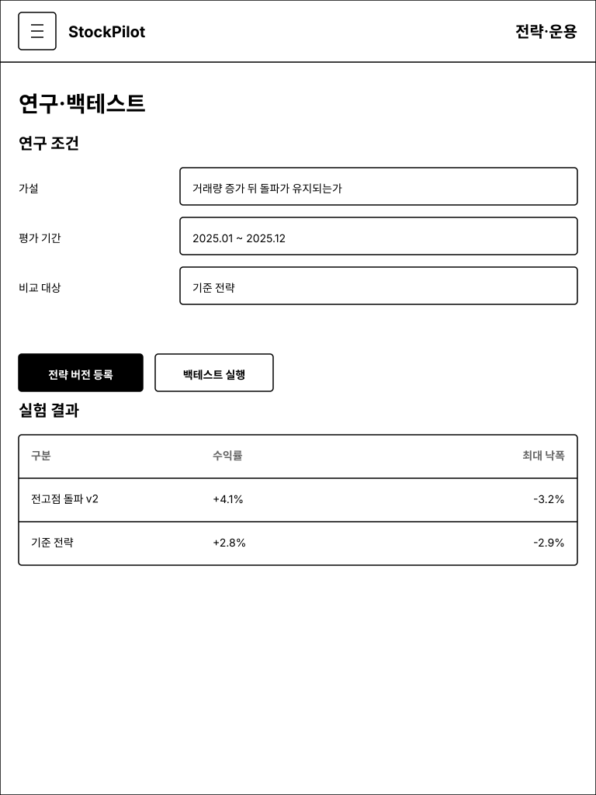

| 후보 선택 후의 실행 설정 | 자료 점검과 실행 동작 |
| --- | --- |
| [일반 전략 시안](wireframes/backtest-minute.svg) | 후보 버전의 확정 1분봉 평가 방식을 표시한다. 시세 구간, 워밍업 자료, 엔진 호환성, 자금·비용 설정을 확인한 뒤 연구를 실행한다. |
| [단타 전략 시안](wireframes/backtest-scalp.svg) | 후보가 사용하는 체결 틱·호가 이력을 종목·기간별로 확인한다. 필수 이력이 부족하면 누락 구간과 미판정 사유를 표시하고 해당 조건의 정식 검증을 막는다. 계좌별 구독량은 향후 실운용 배정 참고값이다. 저장된 이력을 재생할 때는 실시간 구독 용량을 사용하지 않는다. |

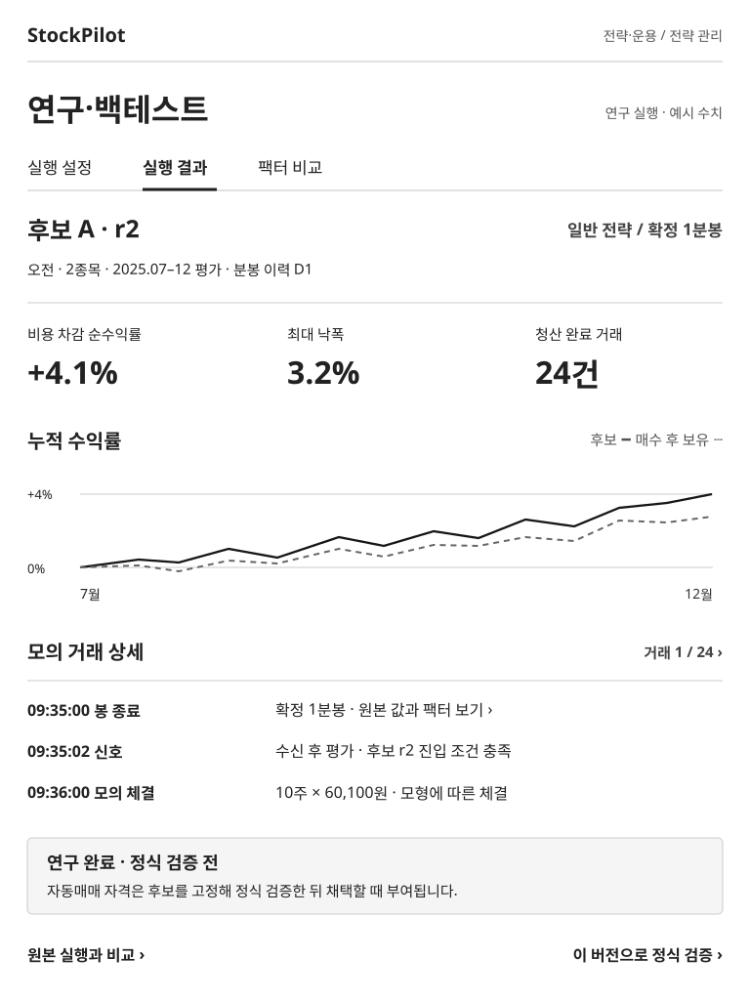

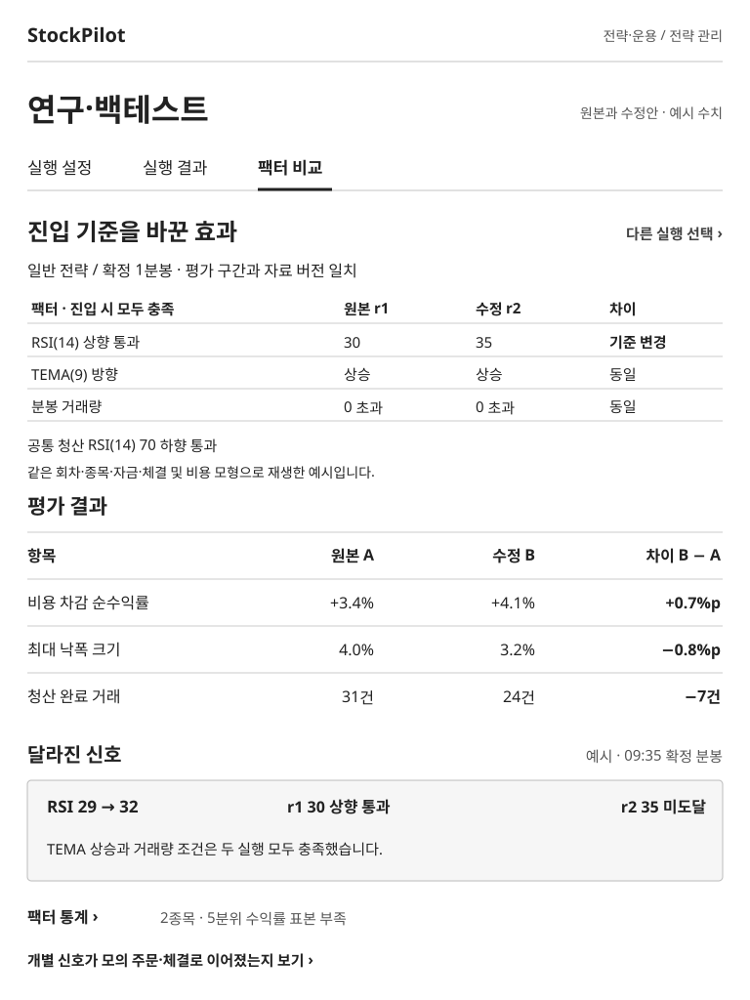

‘팩터 추가’의 선택 항목, 출처, 계산 설정과 맞춤 팩터 등록 항목은 [팩터 정의서](<팩터 정의서.md>)를 따른다.

[팩터 추가 선택 시안](wireframes/backtest-factor-picker.svg)은 1분봉 자료를 쓰는 후보에서 RSI와 TEMA를 함께 선택한 예시다. 필요한 자료가 없는 팩터에는 선택할 수 없는 이유를 표시한다. ‘팩터 2개 추가’를 누르면 편집 화면에서 두 팩터를 진입·청산 조건에 연결할 수 있다.

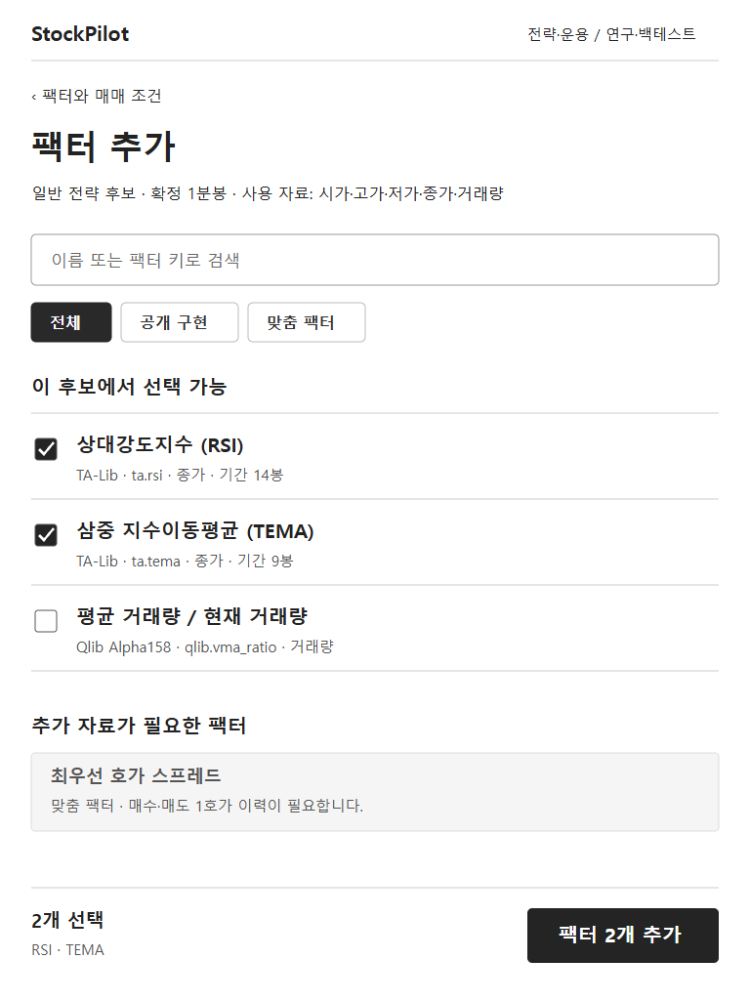

[팩터·조건 편집 시안](wireframes/backtest-factor-editor.svg)은 일반 전략의 원본 r1에서 수정안 r2를 만드는 예시다. ‘팩터 추가’에서 공개 구현이나 학습 자료에 연결한 팩터를 찾고 출처·입력 자료·평가 주기를 확인한다. 단타 후보는 체결 또는 호가 이력 요구사항도 표시한다. 선택한 팩터는 진입과 청산 양쪽에서 재사용할 수 있다. 저장하면 실행 설정에서 자료 점검과 백테스트를 진행한다.

**팩터 구성**에서 투자자는 후보에 필요한 만큼 팩터를 추가·제거하고 각 팩터의 입력, 기간, 기준값, 진입·청산 역할을 정한다. 실행 설정에는 선택 목록과 조합식을 표시한다. 조건식은 AND·OR와 괄호를 보존하고, 가중합을 쓰는 후보는 정규화 방식·가중치·점수 기준을 표시한다. 목록이 길면 펼쳐 전체를 본다. 변경 사항은 새 후보 리비전에 저장한다.

**팩터 비교**에서 달라진 신호 한 건을 열면 같은 시각의 측정값, 두 버전의 조건별 충족 여부, 해당 시점의 모의 주문·체결을 대조한다. 원본과 수정안의 팩터를 행별로 맞춰 추가·제거·기준 변경·동일을 표시하고 조합식 변경도 함께 보여 준다. 여러 항목이 달라졌으면 성과 차이를 조합 전체의 결과로 표시한다. **실행 결과**에서 이전 주간 실행을 고르면 동일 버전의 판정과 평가 구간 변화를 확인한다. 비교 방식, 예제 계산식, 모의 주문 근거와 구현 순서는 [팩터 연구와 백테스트 설계](<팩터 연구와 백테스트 설계.md>)에 정의한다.

**첫 방문**에는 운용 전략 0개, 연구 후보 미선택 상태를 표시한다. 저장소·리비전·예제 경로 또는 학습 자료를 연결하고 규칙과 필요한 팩터를 등록한다. 참조 후보와 수정안을 각각 저장해 비교한다. **실행 결과**에서 투자자가 고른 후보의 정식 검증과 채택 여부를 기록한다.

연구 결과에는 후보 리비전·유형·재생 자료·실행 목적을 표시한다. 일반 전략의 거래 상세는 봉 종료→평가→모의 체결, 단타는 이벤트 수신→신호→주문 도달→모의 체결 순으로 표시한다. 주간 실행에는 이전 판정과 유효 기한을 함께 표시한다. 팩터 비교에서는 원본과 수정안의 차이를 보여 준다. 평가 방식·기간·자료·비용 모형이 다르면 달라진 조건을 표시하고 팩터 단독 효과는 산출하지 않는다. 시안의 후보·거래·성과는 화면 설명용 예시다.

**실행과 결과 조회**

1. **조건 확인.** 후보 리비전·백테스터·시험 회차를 선택하고 당시 대상 종목 목록, 종목별 배정액, 초기 현금, 비교 전략, 자료·비용 버전을 고정한다. 규칙을 정한 연구 기간과 이후의 평가 기간을 따로 둔다. 평가 시작 전 자료는 팩터 계산에 필요한 구간으로만 사용한다.
2. **자료 점검.** 평가 방식과 필요한 이력을 함께 표시한다. 일반 전략은 확정 1분봉, 단타는 지정한 체결·호가 이벤트의 출처와 수집 범위를 확인한다. 행을 열면 출처별 기준 거래일, 이용 가능 시각, 자료 버전, 누락 종목·구간을 확인한다. 필수 자료가 부족하면 미판정으로 남긴다.
3. **과거 거래 재생.** 각 거래일에 해당 회차의 전략을 시작하고 등록한 감시 종료 조건까지 버전에 맞는 분봉 또는 실시간 이벤트를 재생한다. 자료 수신·평가·주문 도달 이후의 가격과 유동성으로 모의 체결한다. 거래 정지 중에는 체결하지 않는다. 보유·미체결 상태, 현금과 배정 잔액을 반영하고 수수료·매도세는 모의 원장에 기록한다.
4. **결과 확인.** 요청 시 실행 ID를 발급한다. 화면을 다시 열면 대기·실행 중·완료·실패 상태를 조회하고 실패 사유를 확인한다. 후보와 비교 전략은 같은 평가 구간·대상·초기 자금·비용 가정으로 재생한다. 일별 순자산과 낙폭, 거래별 신호 시각·팩터값·체결 시각·가격·수량·비용을 조회한다.
5. **판정과 주간 재검증.** 별도로 둔 평가 구간에서 기준 대비 순수익률, 최대 낙폭, 청산 완료 거래 수를 사전 기준과 대조한다. 최초·수동·주간 실행별 결과를 버전 이력에 추가한다. 주간 검증은 해당 버전의 규칙과 기준을 유지하고 평가 창을 옮긴다. 채택 여부와 유효한 검증 판정에 따라 신규 주문 가능 여부를 표시한다.

**기능표**

| 기능 | 사용자 동작 | 표시 결과·예외 | 기능 ID |
| --- | --- | --- | --- |
| 연구 후보 등록 | 공개 소스와 학습 자료에서 시험할 규칙을 정한다. | 원본 참조, 변경점, 조건을 연구 버전에 저장한다. | F-039, F-040, F-017 |
| 비교 실행 | 동일 기간·비용 조건을 지정해 실행한다. | 성과·낙폭을 기준 전략과 비교한다. 최초·수동·주간 실행을 구분하고 항목별 측정값·기준과 최종 판정을 이력에 연결한다. 자료 부족은 미판정이다. | F-018, F-019 |

[화면 목록으로](#화면-목록)

## UI-007

**화면 메뉴명**　전략·운용 → 회차 관리 → 전략 배정

처음 열면 해당 거래일의 모든 계좌와 시작 회차를 함께 보여준다. 시작 회차 필터는 **전체 · 오전 · 오후 · 장 마감 전**이며 기본값은 전체다. 특정 계좌나 회차를 고르면 요약과 상세에 같은 필터를 적용한다.

**전략별 배정 금액** 표는 전략 버전을 한 행에, 계좌를 한 열에 표시한다. 각 칸은 해당 계좌에서 그 버전에 배정한 종목별 매수 운용 한도(원)의 합이다. 오른쪽에는 전략 합계, 아래에는 계좌 합계와 총합을 표시한다. 같은 증권사에 계좌가 여러 개면 계좌별 별칭으로 구분한다. 열이 많으면 전략명을 고정하고 가로로 스크롤한다.

**종목별 배정 내역**은 계좌·시작 회차·전략 버전·종목·배정 금액을 한 행에 표시한다. ‘배정 추가’에서 계좌와 실제 시작 회차를 지정한다. 단타를 배정할 때는 선택 계좌 세션의 사용량·잔여량과 해당 행으로 늘어나는 구독량을 표시한다. 기존 구독을 공유하면 추가 사용량은 0이다. 실행 시 여유가 없으면 구독 대기와 사유를 표시한다.

**API**

| 구분 | 인터페이스 | 호출 방식·경로 |
| --- | --- | --- |
| 화면 API | [IF-012 회차별 전략 배정](<인터페이스 정의서.md#if-012>) | `PUT /strategy-assignments/{trade_date}/{slot}` |
| 추가 설계 | IF-012 확장안 · 거래일 기준 본인 전체 계좌의 배정 ID·계좌·시작 회차·전략 버전·종목 코드·금액을 조회한다. 행별 저장은 지정한 계좌·회차의 변경 건에만 적용한다. | `GET /strategy-assignments/{trade_date}` · 채택 버전 조회 `GET /strategies/versions?eligible_for_live=true` |

**화면 구성 예시**

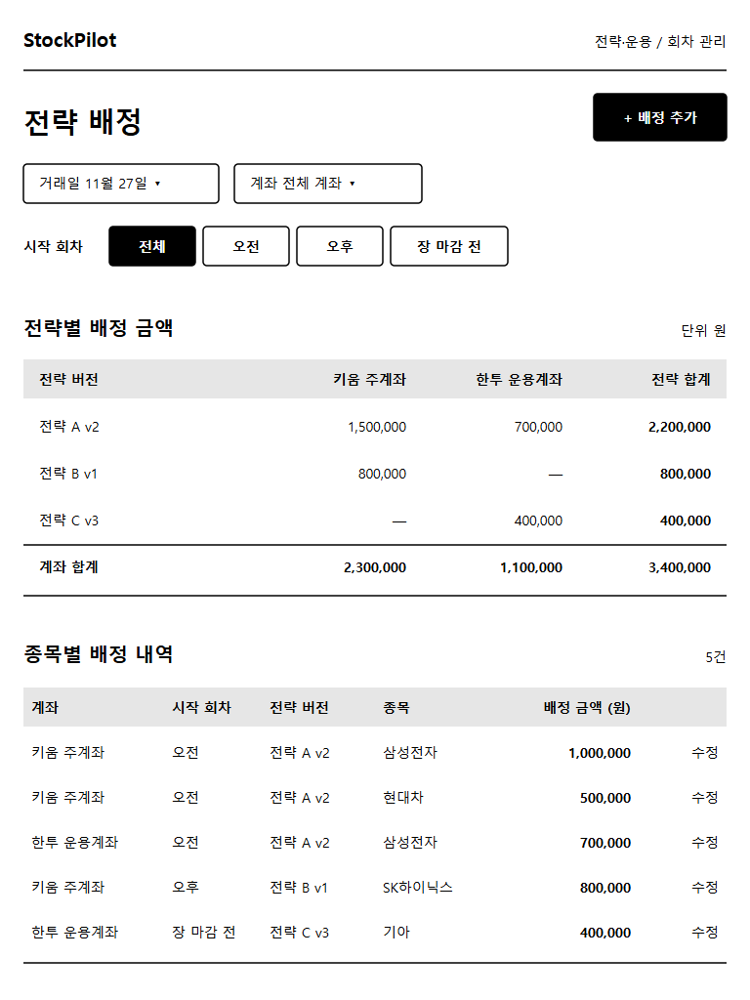

**기능표**

| 기능 | 사용자 동작 | 표시 결과·예외 | 기능 ID |
| --- | --- | --- | --- |
| 배정 조회 | 거래일·계좌·시작 회차로 조회한다. | 필터에 맞는 배정 ID를 한 번씩 합산한다. 오전에 시작해 오후까지 유효한 배정은 오전으로 집계한다. 결과가 없으면 합계 0원과 빈 내역을 표시한다. | F-028 |
| 배정 추가·수정 | ‘배정 추가’ 또는 상세 행의 ‘수정’을 눌러 계좌·시작 회차·채택 버전·종목·금액을 지정한다. | 미검증·보류·만료 버전은 사유와 이력을 표시하고 신규 배정을 막는다. 같은 계좌·회차·버전에 종목 행을 추가하거나 삭제할 수 있다. | F-028 |
| 저장 | 종목 코드와 양수 원화 금액을 확인하고 저장한다. | 저장된 항목별 ID·금액과 합계를 확인한다. 누락·잘못된 금액은 해당 행에 표시한다. 이전 판단·주문에는 당시 배정 금액을 보존한다. | F-028, F-029 |

[화면 목록으로](#화면-목록)

## UI-008

**화면 메뉴명**　전략·운용 → 회차 관리 → 실행 이력

거래일별로 회차가 실행됐는지와 건너뛴 이유를 확인한다.

**API**

| 구분 | 인터페이스 | 호출 방식·경로 |
| --- | --- | --- |
| 화면 API | [IF-026 회차 실행 이력](<인터페이스 정의서.md#if-026>) | `GET /accounts/{account_id}/sessions` |

**화면 구성 예시**

**기능표**

| 기능 | 사용자 동작 | 표시 결과·예외 | 기능 ID |
| --- | --- | --- | --- |
| 실행 조회 | 거래일과 선택 회차로 검색한다. | 실행·관망·휴장·중지·실패 사유를 구분한다. | F-089 |
| 회차 선택 | 회차 행을 누른다. | 선택 계좌와 원래 회차를 유지해 후보·판단 상세를 연다. | F-029, F-084 |

[화면 목록으로](#화면-목록)

## UI-009

**화면 메뉴명**　전략·운용 → 회차 관리 → 회차 상세

후보 순위와 제외 근거, AI가 실제 수량을 결정한 이유를 읽는다.

**API**

| 구분 | 인터페이스 | 호출 방식·경로 |
| --- | --- | --- |
| 화면 API | [IF-027 후보 순위·제외 사유](<인터페이스 정의서.md#if-027>) | `GET /accounts/{account_id}/sessions/{session_id}/candidates` |
| 화면 API | [IF-013 회차 판단 상세](<인터페이스 정의서.md#if-013>) | `GET /accounts/{account_id}/sessions/{session_id}/decisions/{decision_id}` |

**화면 구성 예시**

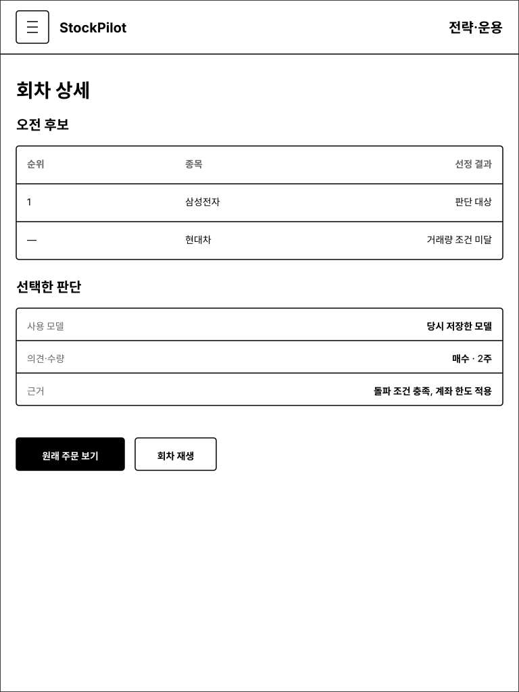

**기능표**

| 기능 | 사용자 동작 | 표시 결과·예외 | 기능 ID |
| --- | --- | --- | --- |
| 후보 조회 | 후보 목록을 넘기거나 종목을 선택한다. | 선정 순위와 제외 사유를 확인한다. | F-084, F-085 |
| 판단 근거 | 실행된 판단을 선택한다. | 배정 ID·종목·당시 배정 금액과 모델·수량 근거를 보여준다. 관망 또는 보류면 해당 사유를 표시한다. | F-037, F-038, F-032 |

[화면 목록으로](#화면-목록)

## UI-010

**화면 메뉴명**　전략·운용 → 회차 관리 → 과거 회차 재생

당시 입력을 고정해 재계산한 신호와 원래 판단을 비교한다.

**API**

| 구분 | 인터페이스 | 호출 방식·경로 |
| --- | --- | --- |
| 화면 API | [IF-030 실제 회차 재생](<인터페이스 정의서.md#if-030>) | `POST /accounts/{account_id}/sessions/{session_id}/replays` |

**화면 구성 예시**

**기능표**

| 기능 | 사용자 동작 | 표시 결과·예외 | 기능 ID |
| --- | --- | --- | --- |
| 재생 요청 | 원래 회차·자료·전략 버전으로 실행한다. | 모의 결과를 표시하고 실계좌 주문은 생성하지 않는다. | F-092 |
| 결과 비교 | 원래 신호와 재계산 신호를 비교한다. | 보존한 AI 응답과 체결을 참조한다. 원본 자료가 없으면 재생 불가 사유를 표시한다. | F-092 |

[화면 목록으로](#화면-목록)

## UI-011

**화면 메뉴명**　전략·운용 → 종목·시장 분석

종목 분석과 시장 전망의 기준 시각·근거를 확인한다. 시장 전망에서 근거를 열면 관측값별 수집 채널(예: KRX OPEN API), 기준 거래일, 수신 시각을 확인한다. [시장 자료 수집](<01. 전체 아키텍처.md#시장-분석용-데이터-수집>)

**API**

| 구분 | 인터페이스 | 호출 방식·경로 |
| --- | --- | --- |
| 서버 내부 | [IF-033 과거 시점 자료 조회](<인터페이스 정의서.md#if-033>) | `내부 조회` |
| 서버 내부 | [IF-036 종목·시장 분석 해석](<인터페이스 정의서.md#if-036>) | `내부 분석 요청` |
| 서버 내부 | [IF-056 시장 전망 사후 평가](<인터페이스 정의서.md#if-056>) | `내부 평가 호출` |
| 추가 설계 | 종목 분석·시장 전망·사후 평가 결과 조회 API | `GET /market/analysis?symbol=…&as_of=…` · `GET /market/outlooks` |

**화면 구성 예시**

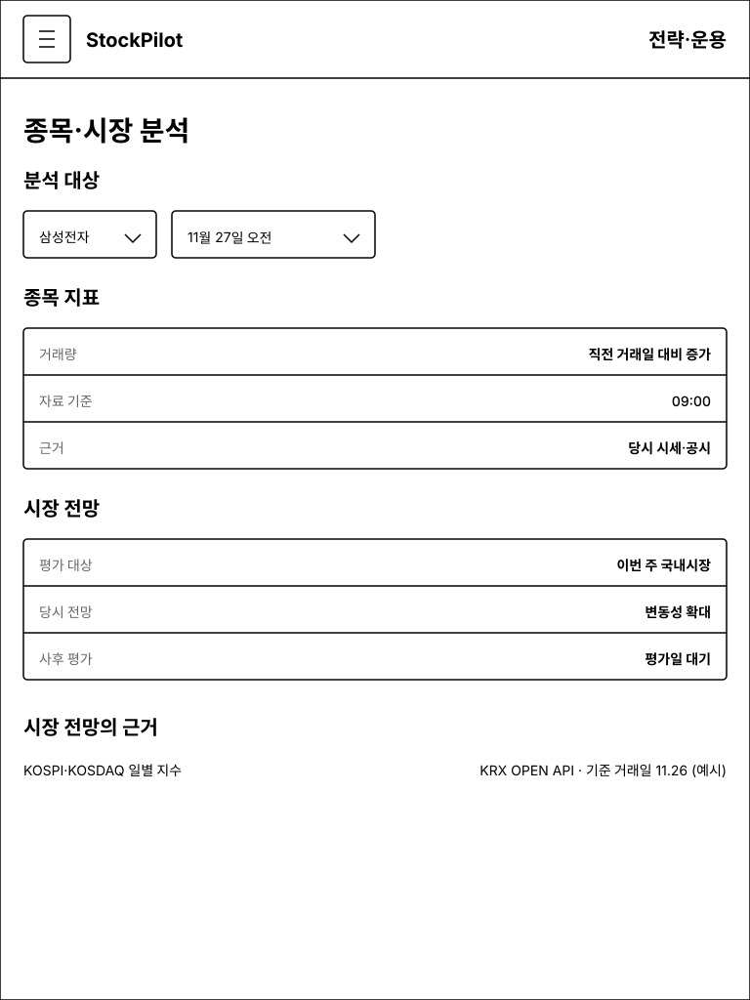

**기능표**

| 기능 | 사용자 동작 | 표시 결과·예외 | 기능 ID |
| --- | --- | --- | --- |
| 종목 분석 | 종목과 시점을 선택한다. | 그 시점에 이용 가능했던 자료와 지표 근거를 표시한다. | F-013, F-014, F-033 |
| 시장 전망 | 기간과 전망을 선택한다. | 최초 전망과 사후 평가를 구분하고 평가일 전이면 대기로 표시한다. | F-015, F-016, F-034 |

[화면 목록으로](#화면-목록)

## UI-012

**화면 메뉴명**　전략·운용 → 종목·시장 분석 → 관심종목

투자자가 추적할 종목 목록을 관리한다.

**API**

| 구분 | 인터페이스 | 호출 방식·경로 |
| --- | --- | --- |
| 화면 API | [IF-023 관심종목 목록 조회](<인터페이스 정의서.md#if-023>) | `GET /watchlist/symbols` |
| 화면 API | [IF-024 관심종목 추가](<인터페이스 정의서.md#if-024>) | `PUT /watchlist/symbols/{symbol}` |
| 화면 API | [IF-025 관심종목 해제](<인터페이스 정의서.md#if-025>) | `DELETE /watchlist/symbols/{symbol}` |

**화면 구성 예시**

**기능표**

| 기능 | 사용자 동작 | 표시 결과·예외 | 기능 ID |
| --- | --- | --- | --- |
| 종목 추가 | 종목 코드를 입력해 저장한다. | 같은 코드를 다시 추가해도 한 행만 표시한다. | F-094 |
| 목록·해제 | 목록에서 종목을 해제한다. | 갱신된 본인 목록을 표시한다. 운용에 배정한 종목은 오늘의 전략 운용에서 평가 상태를 확인한다. | F-094, F-101 |

[화면 목록으로](#화면-목록)

## UI-013

**화면 메뉴명**　거래·리포트 → 주문·체결 이력

자동주문과 직접 낸 개인 주문을 같은 기준으로 찾는다.

**API**

| 구분 | 인터페이스 | 호출 방식·경로 |
| --- | --- | --- |
| 화면 API | [IF-017 주문 이력 조회](<인터페이스 정의서.md#if-017>) | `GET /accounts/{account_id}/orders` |
| 추가 설계 | 전체 기간의 미체결 필터를 위한 IF-017 상태 필터 확장 | `GET /accounts/{account_id}/orders?open_only=true` |

**화면 구성 예시**

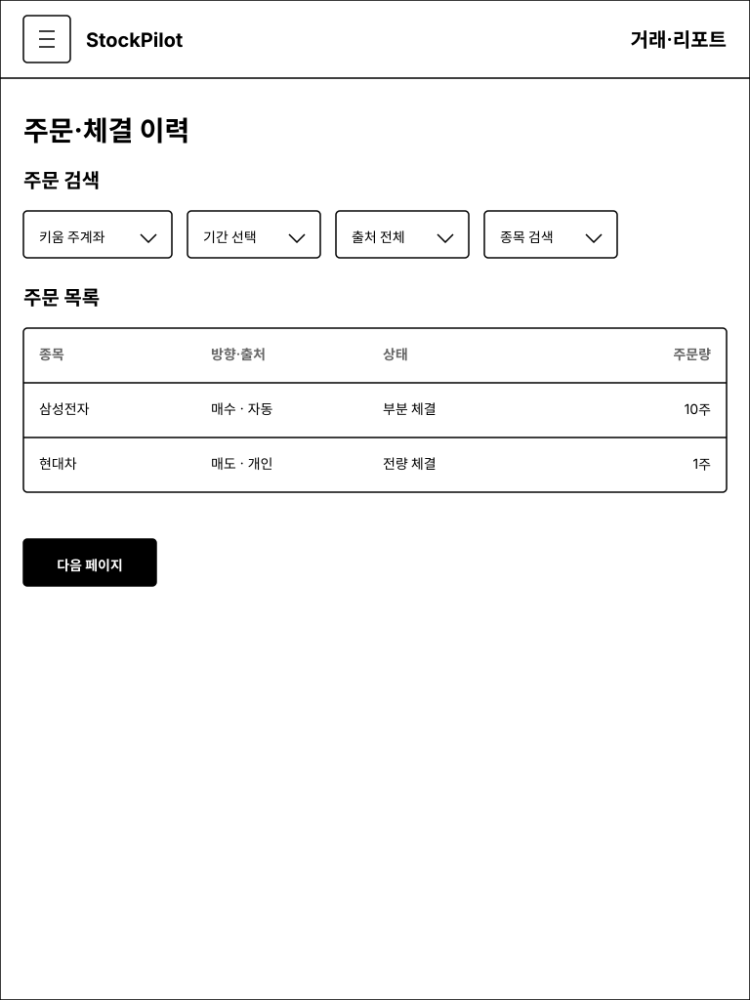

**기능표**

| 기능 | 사용자 동작 | 표시 결과·예외 | 기능 ID |
| --- | --- | --- | --- |
| 필터·페이지 | 계좌·기간·출처·종목으로 검색하고 다음 페이지를 연다. | 운용 항목에서 진입하면 배정 ID 필터를 유지한다(추가 설계). 같은 전략의 다른 종목 주문과 개인 주문을 섞지 않는다. 빈 결과와 동기화 실패를 구분한다. | F-062 |
| 주문 상세 이동 | 자동 또는 개인 주문 행을 선택한다. | 원주문의 개별 체결을 연다. 돌아오면 필터와 목록 위치를 복원한다. | F-098 |

[화면 목록으로](#화면-목록)

## UI-014

**화면 메뉴명**　거래·리포트 → 주문·체결 이력 → 주문 상세

한 주문의 접수부터 취소·개별 체결·원장 반영까지 확인한다.

**API**

| 구분 | 인터페이스 | 호출 방식·경로 |
| --- | --- | --- |
| 화면 API | [IF-018 주문 상세 조회](<인터페이스 정의서.md#if-018>) | `GET /accounts/{account_id}/orders/{order_id}` |
| 화면 API | [IF-013 회차 판단 상세](<인터페이스 정의서.md#if-013>) | `GET /accounts/{account_id}/sessions/{session_id}/decisions/{decision_id}` |

**화면 구성 예시**

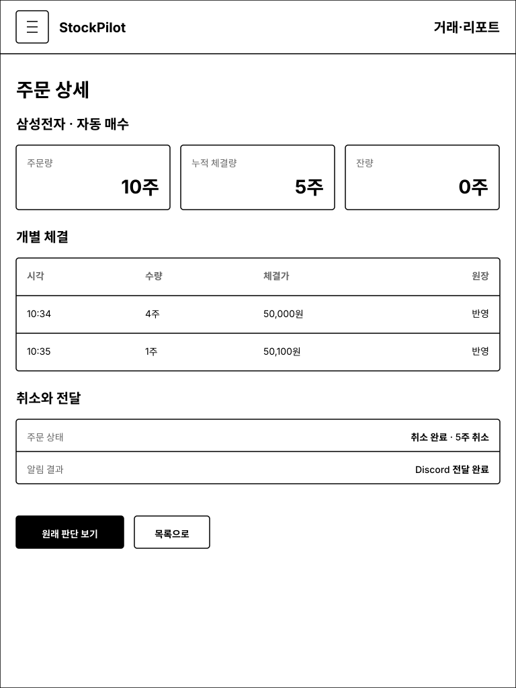

**기능표**

| 기능 | 사용자 동작 | 표시 결과·예외 | 기능 ID |
| --- | --- | --- | --- |
| 수량 확인 | 체결 내역과 취소 결과를 펼친다. | 같은 체결은 한 줄이다. 미확인 수량은 0으로 대체하지 않는다. | F-054, F-055, F-056, F-098 |
| 근거·알림 조회 | 자동주문 판단 또는 알림 결과를 확인한다. | 자동주문은 원래 배정 ID·회차·종목·당시 금액으로 연결한다. 개인 주문은 배정 ‘해당 없음’, 과거 자동주문의 배정 근거가 없으면 ‘확인 불가’로 표시한다. | F-059, F-098 |

[화면 목록으로](#화면-목록)

## UI-015

**화면 메뉴명**　거래·리포트 → 주간 운용 리포트

주초 운용 자산과 실제 손익을 비교하고 근거 거래를 확인한다.

**API**

| 구분 | 인터페이스 | 호출 방식·경로 |
| --- | --- | --- |
| 화면 API | [IF-014 주간 성과 조회](<인터페이스 정의서.md#if-014>) | `GET /reports/weekly/{week}` |
| 서버 내부 | [IF-039 운용 해설·일지 복기 질문](<인터페이스 정의서.md#if-039>) | `내부 생성 요청` |
| 추가 설계 | AI 해설을 화면에 전달할 응답 필드 또는 별도 화면 API | `GET /reports/weekly/{week} 응답에 commentary와 근거 참조 추가` |

**화면 구성 예시**

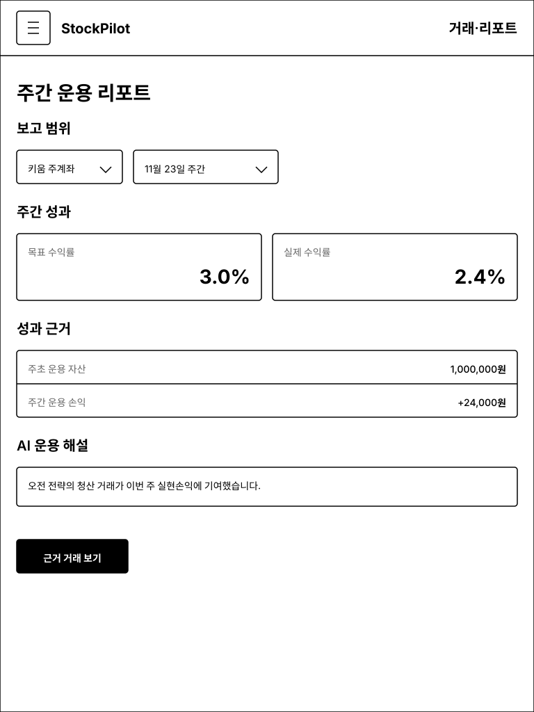

**기능표**

| 기능 | 사용자 동작 | 표시 결과·예외 | 기능 ID |
| --- | --- | --- | --- |
| 주간 조회 | 평가 주와 계좌 범위를 선택한다. | 주초 자산·운용 손익·목표·실제 수익률을 표시한다. 입출금은 운용 손익에서 구분한다. | F-077, F-078, F-079, F-080 |
| 해설 근거 | AI 해설의 거래 참조를 연다. | 실제 판단·체결·원장과 연결한다. 해설 실패 시에도 산출된 성과는 조회한다. | F-042 |

[화면 목록으로](#화면-목록)

## UI-016

**화면 메뉴명**　거래·리포트 → 손익·체결가 분석 → 매매 방식별 실현손익

청산된 거래의 손익을 매매 방식별로 확인한다.

**API**

| 구분 | 인터페이스 | 호출 방식·경로 |
| --- | --- | --- |
| 화면 API | [IF-022 매매 방식별 실현손익](<인터페이스 정의서.md#if-022>) | `GET /accounts/{account_id}/realized-pnl` |

**화면 구성 예시**

**기능표**

| 기능 | 사용자 동작 | 표시 결과·예외 | 기능 ID |
| --- | --- | --- | --- |
| 방식 필터 | 직접 매매·자동매매·혼합·미확인 중 선택한다. | 해당 거래와 계좌 합계를 구분해 표시한다. | F-063 |
| 원거래 조회 | 청산 거래를 선택한다. | 취득·매도 주문을 연결한다. 혼합 거래의 손익은 한 번 집계한다. | F-063, F-098 |

[화면 목록으로](#화면-목록)

## UI-017

**화면 메뉴명**　거래·리포트 → 손익·체결가 분석 → 종목별 평가손익

보유 종목의 일자별 평가손익을 조회한다.

**API**

| 구분 | 인터페이스 | 호출 방식·경로 |
| --- | --- | --- |
| 화면 API | [IF-021 종목별 평가손익 이력](<인터페이스 정의서.md#if-021>) | `GET /accounts/{account_id}/valuation-history` |

**화면 구성 예시**

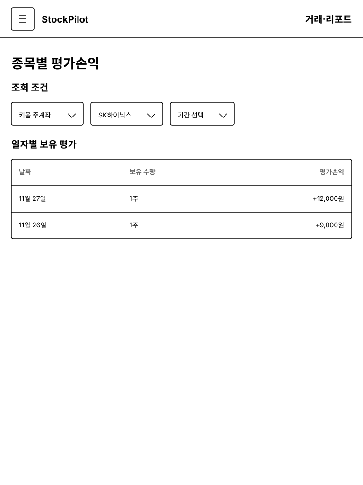

**기능표**

| 기능 | 사용자 동작 | 표시 결과·예외 | 기능 ID |
| --- | --- | --- | --- |
| 종목·기간 선택 | 종목과 시작·종료일을 입력한다. | 날짜별 평가손익과 기준일을 표시한다. | F-091 |
| 기록 확인 | 대상 기간의 보유 기록을 확인한다. | 평가 이력이 없는 기간은 빈 결과로 표시한다. | F-091 |

[화면 목록으로](#화면-목록)

## UI-018

**화면 메뉴명**　거래·리포트 → 손익·체결가 분석 → 체결가 분석

판단 당시 예상가와 실제 개별 체결가를 대조한다.

**API**

| 구분 | 인터페이스 | 호출 방식·경로 |
| --- | --- | --- |
| 화면 API | [IF-031 예상가와 체결가 차이 조회](<인터페이스 정의서.md#if-031>) | `GET /accounts/{account_id}/execution-prices` |

**화면 구성 예시**

**기능표**

| 기능 | 사용자 동작 | 표시 결과·예외 | 기능 ID |
| --- | --- | --- | --- |
| 체결 비교 | 기간·종목 또는 전략 버전을 선택한다. | 매수·매도 방향, 예상가와 체결가·수량을 표시한다. | F-093 |
| 근거 확인 | 체결 행을 선택한다. | 해당 주문을 연다. 예상가가 없으면 차이를 산출할 수 없다고 표시한다. | F-093, F-098 |

[화면 목록으로](#화면-목록)

## UI-019

**화면 메뉴명**　거래·리포트 → 매매일지

당시 생각과 사후 복기를 계좌·회차·주문에 연결한다.

**API**

| 구분 | 인터페이스 | 호출 방식·경로 |
| --- | --- | --- |
| 화면 API | [IF-016 매매일지 조회](<인터페이스 정의서.md#if-016>) | `GET /journal/entries` |
| 화면 API | [IF-015 매매일지 기록](<인터페이스 정의서.md#if-015>) | `POST /journal/entries` |
| 서버 내부 | [IF-039 운용 해설·일지 복기 질문](<인터페이스 정의서.md#if-039>) | `내부 생성 요청` |
| 추가 설계 | 복기 질문을 화면에 전달하는 API | `POST /journal/review-questions` |

**화면 구성 예시**

**기능표**

| 기능 | 사용자 동작 | 표시 결과·예외 | 기능 ID |
| --- | --- | --- | --- |
| 일지 작성 | 유형과 메모를 입력하고 저장한다. | 판단 메모와 사후 복기를 구분하고 기존 기록을 보존한다. | F-081, F-082 |
| 기록 조회 | 계좌·회차·주문으로 조회한다. | 선택한 기록과 근거 거래를 확인한다. AI 복기 질문은 투자자 작성 메모와 구분한다. | F-083, F-043 |

[화면 목록으로](#화면-목록)

## UI-020

**화면 메뉴명**　설정 → 계좌 연결·API 키

계좌를 확인한 뒤 증권사 자격 증명을 등록하거나 교체한다.

**API**

| 구분 | 인터페이스 | 호출 방식·경로 |
| --- | --- | --- |
| 화면 API | [IF-003 계좌 목록 조회](<인터페이스 정의서.md#if-003>) | `GET /accounts` |
| 화면 API | [IF-005 증권사 키 등록](<인터페이스 정의서.md#if-005>) | `POST /accounts/{account_id}/credentials` |
| 화면 API | [IF-006 증권사 키 교체](<인터페이스 정의서.md#if-006>) | `PUT /accounts/{account_id}/credentials/current` |
| 화면 API | [IF-007 증권사 연결 확인](<인터페이스 정의서.md#if-007>) | `POST /accounts/{account_id}/connection-checks` |
| 화면 API | [IF-008 증권사 연결 해제](<인터페이스 정의서.md#if-008>) | `DELETE /accounts/{account_id}/credentials/current` |

**화면 구성 예시**

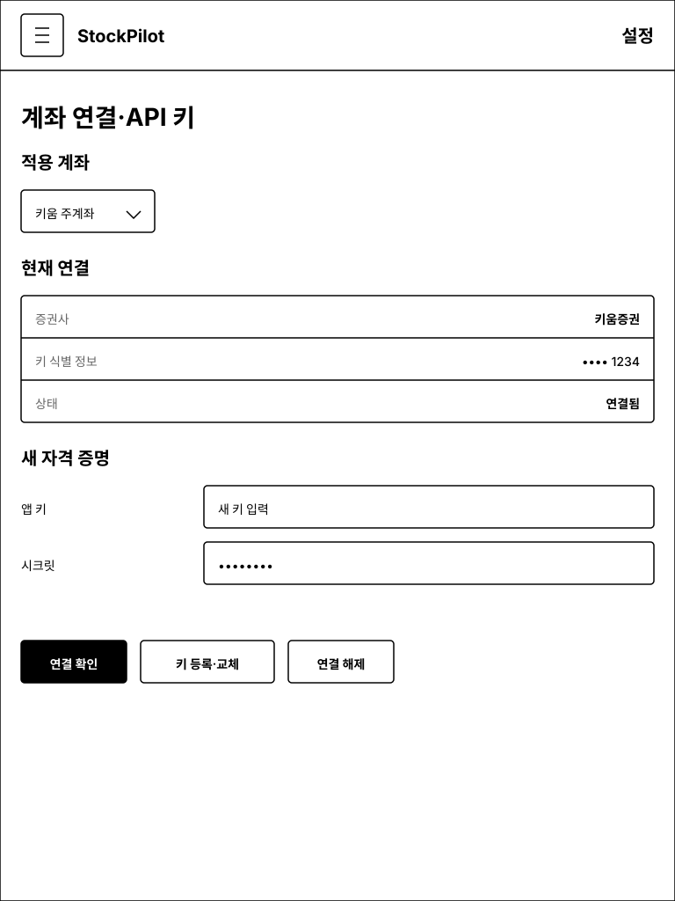

**기능표**

| 기능 | 사용자 동작 | 표시 결과·예외 | 기능 ID |
| --- | --- | --- | --- |
| 등록·교체 | 본인 계좌를 고르고 새 키로 대상 계좌 조회를 검증한다. | 검증 성공 후 저장한다. 교체 실패 시 기존 연결을 유지한다. | F-005, F-006, F-007 |
| 연결 해제 | 해제할 계좌를 확인하고 실행한다. | 연결 해제 결과가 보이고 해당 연결의 신규 자동주문을 중단한다. | F-008 |

[화면 목록으로](#화면-목록)

## UI-021

**화면 메뉴명**　설정 → 계좌별 운용 설정

계좌별 자동매매 여부와 한도·위험 기준을 관리한다.

**API**

| 구분 | 인터페이스 | 호출 방식·경로 |
| --- | --- | --- |
| 화면 API | [IF-009 계좌 운용 설정 조회](<인터페이스 정의서.md#if-009>) | `GET /accounts/{account_id}/settings` |
| 화면 API | [IF-010 계좌 운용 설정 저장](<인터페이스 정의서.md#if-010>) | `PUT /accounts/{account_id}/settings` |
| 서버 내부 | [IF-057 계좌 위험 평가·자동 중지 통지](<인터페이스 정의서.md#if-057>) | `내부 상태 이벤트` |
| 추가 설계 | 위험 임계값 조회·편집 필드와 재개 정책 | `GET·PUT /accounts/{account_id}/settings 위험 기준 필드 확장` |

**화면 구성 예시**

**기능표**

| 기능 | 사용자 동작 | 표시 결과·예외 | 기능 ID |
| --- | --- | --- | --- |
| 계좌 한도 | 정액 또는 비율을 선택해 값을 저장한다. | 대상 계좌에만 적용한다. 저장 실패 시 직전 적용값을 표시한다. | F-023, F-024, F-026 |
| 자동매매 전환 | 계좌의 자동매매를 끈다. | 신규 자동주문을 막고 기존 주문과 개인 거래는 추적한다. 자동 중지 사유도 별도 표시한다. | F-021, F-022, F-087, F-088 |

[화면 목록으로](#화면-목록)

## UI-022

**화면 메뉴명**　설정 → AI 모델·수량 기준

사용자 공통 모델과 선택 계좌의 주문당 수량 기준을 구분한다.

**API**

| 구분 | 인터페이스 | 호출 방식·경로 |
| --- | --- | --- |
| 화면 API | [IF-028 AI 모델 설정 조회](<인터페이스 정의서.md#if-028>) | `GET /settings/ai-model` |
| 화면 API | [IF-029 AI 모델 설정 저장](<인터페이스 정의서.md#if-029>) | `PUT /settings/ai-model` |
| 화면 API | [IF-009 계좌 운용 설정 조회](<인터페이스 정의서.md#if-009>) | `GET /accounts/{account_id}/settings` |
| 화면 API | [IF-010 계좌 운용 설정 저장](<인터페이스 정의서.md#if-010>) | `PUT /accounts/{account_id}/settings` |

**화면 구성 예시**

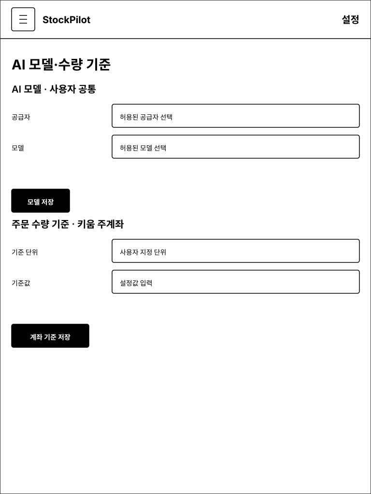

**기능표**

| 기능 | 사용자 동작 | 표시 결과·예외 | 기능 ID |
| --- | --- | --- | --- |
| 모델 설정 | 허용된 공급자·모델을 선택해 저장한다. | 새 판단에 적용할 버전을 확인하며 과거 회차의 모델 기록은 보존한다. | F-095 |
| 수량 기준 | 대상 계좌의 단위와 기준값을 저장한다. | 기존 운용 설정을 읽고 같은 버전 기준으로 수정한다. 지원 단위는 검토 중이다. | F-025, F-026 |

[화면 목록으로](#화면-목록)

## UI-023

**화면 메뉴명**　설정 → 주간 목표

적용할 주와 목표 수익률을 저장한다.

**API**

| 구분 | 인터페이스 | 호출 방식·경로 |
| --- | --- | --- |
| 화면 API | [IF-011 주간 목표 설정](<인터페이스 정의서.md#if-011>) | `PUT /weekly-targets/{effective_week}` |
| 화면 API | [IF-014 주간 성과 조회](<인터페이스 정의서.md#if-014>) | `GET /reports/weekly/{week}` |
| 추가 설계 | 성과 산출 전 적용 예정 목표를 읽는 화면 API | `GET /weekly-targets/{effective_week}` |

**화면 구성 예시**

**기능표**

| 기능 | 사용자 동작 | 표시 결과·예외 | 기능 ID |
| --- | --- | --- | --- |
| 목표 설정 | 적용 주와 백분율 값을 입력한다. | 해당 주의 목표로 저장한다. 3은 3%를 뜻한다. | F-009 |
| 반영 확인 | 해당 주의 리포트를 연다. | 적용 목표와 실제 성과를 별도 값으로 확인한다. | F-080 |

[화면 목록으로](#화면-목록)

## UI-024

**화면 메뉴명**　설정 → 알림 채널

선택 계좌의 주문·체결 결과를 받을 채널을 설정한다.

**API**

| 구분 | 인터페이스 | 호출 방식·경로 |
| --- | --- | --- |
| 서버 내부 | [IF-048 주문·체결 알림 접수](<인터페이스 정의서.md#if-048>) | `비동기 상태 이벤트` |
| 외부 연동 | [IF-049 알림 채널 전달](<인터페이스 정의서.md#if-049>) | `외부 메시지 전송` |
| 추가 설계 | 계좌별 알림 채널 조회·저장·해제용 화면 API 및 대응 기능 ID | `GET·PUT /accounts/{account_id}/notification-channels` · `DELETE /accounts/{account_id}/notification-channels/{channel_id}` |

**화면 구성 예시**

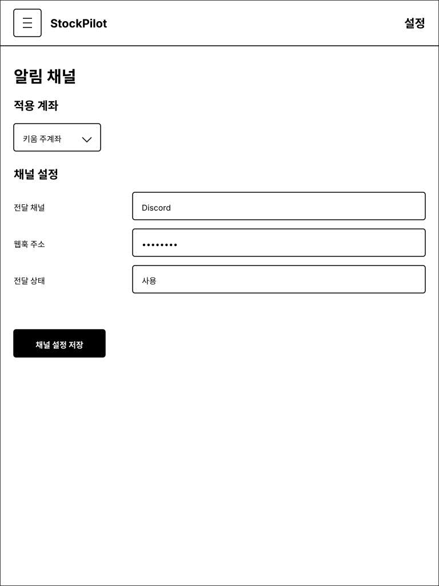

**기능표**

| 기능 | 사용자 동작 | 표시 결과·예외 | 기능 ID |
| --- | --- | --- | --- |
| 채널 설정 | Discord 또는 Slack과 목적지를 선택한다. | 계좌별 전달 설정을 표시하고 저장한 웹훅 주소 원문은 다시 노출하지 않는다. | 화면 기능 추가 정의 |
| 전달 확인 | 주문 상세의 채널별 결과를 확인한다. | 전달 실패는 해당 채널만 재시도한다. 알림 때문에 주문을 다시 전송하지 않는다. | F-070~076·098 |

[화면 목록으로](#화면-목록)

## UI-025

**화면 메뉴명**　설정 → 감사 로그

본인 또는 시스템이 수행한 계좌 작업과 결과를 추적한다.

**API**

| 구분 | 인터페이스 | 호출 방식·경로 |
| --- | --- | --- |
| 화면 API | [IF-063 감사 로그 조회](<인터페이스 정의서.md#if-063>) | `GET /audit-events` |

**화면 구성 예시**

**기능표**

| 기능 | 사용자 동작 | 표시 결과·예외 | 기능 ID |
| --- | --- | --- | --- |
| 감사 검색 | 기간·계좌·작업·결과로 필터한다. | 계좌 없는 본인 로그인도 조회한다. 접근 권한 밖의 계좌 기록은 반환하지 않는다. | F-100 |
| 사건 확인 | 사건을 선택해 세부 정보를 연다. | 허용된 설정 전후 값·실패 사유를 읽고 관련 주문을 연다. 비밀값은 제외한다. | F-099, F-100 |

[화면 목록으로](#화면-목록)

## UI-026

**화면 메뉴명**　홈 → 전체 계좌 요약 → 달력 날짜 선택 → 일일 일지

달력에서 선택한 하루의 메모를 작성하거나 수정하는 하위 화면이다. 휴장일에도 기록할 수 있다. 회차·주문에 연결한 메모는 [매매일지](#ui-019)에서 조회한다.

**API**

| 구분 | 인터페이스 | 호출 방식·경로 |
| --- | --- | --- |
| 추가 설계 | 로그인 사용자가 선택한 날짜의 메모를 조회한다. | `GET /journal/days/{date}` |
| 추가 설계 | 같은 사용자·날짜의 메모 한 건을 저장한다. | `PUT /journal/days/{date}` |

**화면 구성 예시**

**기능표**

| 기능 | 사용자 동작 | 표시 결과·예외 | 기능 ID |
| --- | --- | --- | --- |
| 날짜 열기 | 달력에서 날짜를 누른다. | 해당 날짜와 손익을 표시한다. 일지가 없으면 빈 입력란, 있으면 기존 내용이 열린다. 조회 실패 시 다시 조회할 수 있다. | 신규 제안 |
| 일지 저장 | 메모를 입력하고 저장한다. | 저장 성공 시 원래 월의 달력으로 돌아와 해당 날짜에 ●를 표시한다. 실패하면 편집 중인 내용과 날짜를 유지한다. | 신규 제안 |
| 달력으로 돌아가기 | ‘달력으로’를 선택한다. | 보던 월과 날짜로 돌아간다. 저장하지 않은 새 메모에는 ●가 생기지 않는다. | 신규 제안 |

[메인 대시보드로](#ui-002) · [화면 목록으로](#화면-목록)

## 목록과 상세의 주문 상태

목록에는 최신 상태와 누적 수량을, 상세에는 같은 상태명과 그 상태를 설명하는 체결·취소 내역을 표시한다. 상태를 색상과 텍스트로 함께 보여준다. 수량에는 ‘주’, 원화에는 ‘원’, 비율에는 ‘%’를 붙인다.

| 10주 매수 주문에서 일어난 사건 | 목록의 상태 | 상세에서 확인할 값 |
|---|---|---|
| 전송 후 접수 응답 유실 | 접수 확인 중 | 전송 시각, 마지막 대조 시각. 확인되지 않은 체결량은 미확인으로 표시한다. |
| 접수 확인 후 첫 4주 체결 | 부분 체결 | 개별 체결 4주, 누적 4주, 잔량 6주 |
| 6주 취소 요청 후 1주 추가 체결 | 취소 확인 중 | 개별 체결 두 줄(4주, 1주), 누적 5주, 잔량 5주. 반복 통지가 와도 줄 수는 그대로다. |
| 남은 5주 취소 확정 | 취소 완료 | 누적 체결 5주, 취소 확정 5주, 잔량 0주. 시작 보유 0주라면 원장 보유는 5주다. |

**태블릿 검수.** 세로 화면에서 계좌·상태·기준 시각을 먼저 읽을 수 있는지, 주문 상세에서 뒤로 갔을 때 같은 행과 필터로 돌아오는지 확인한다. 긴 체결 표는 표 안에서 가로로 이동한다. 필터와 상세 이동은 키보드로도 조작할 수 있어야 한다. [업무 흐름·상태 전이서](<업무 흐름·상태 전이서.md>) · [인터페이스 정의서](<인터페이스 정의서.md>)
